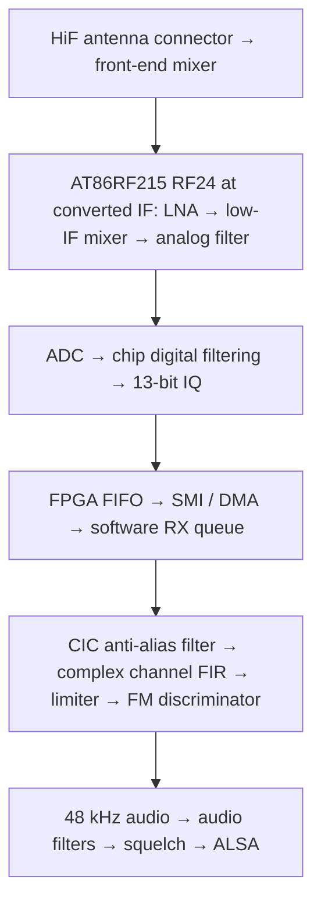

# Menu 14 NBFM RX chain and sensitivity investigation

Recorded 2026-10-10 from source inspection at revision
`60c6138` (`Fix TX-to-RX stream handoff`).

## Deviation configuration (2026-10-10)

The temporary **±5 kHz** experiment has been reverted at the user's request
for their **12.5 kHz channel spacing**. NBFM TX defaults and RX discriminator
normalization again use **±2.5 kHz**, matching the analysis below.

The setting is shared in
[nbfm_defaults.h](../software/libcariboulite/src/nbfm_defaults.h):
`NBFM_DEFAULT_DEVIATION_HZ = 2500.0f`. It applies to TX menus 11/14, the
physical baseline runner, modem self-test, memory demo and the modulator's
NULL-config default, as well as NBFM RX normalization. Explicit caller-supplied
TX deviation values retain their usual meaning.

Noise-squelch RMS thresholds are restored to **0.12/0.18**, with the original
RX PCM and raw discriminator scaling. Filtering, the angle approximation and
the captured IQ are unchanged by this experiment.

After changing the shared constant, rebuild:

```sh
cmake --build build --target cariboulite_test_app nbfm_memory_demo -j2
```

## Investigation context

The user is investigating weak-signal reception in the **menu 14 NBFM receiver
at 430.125 MHz**. The transmitter's actual FM deviation has not been confirmed;
the current receiver normalizes discriminator output for **±2.5 kHz deviation**.

The first software improvement, **complex channel filtering before FM
demodulation**, is now implemented with a **±6 kHz passband** and stopband from
**±9 kHz**. See the [filter design and checks](nbfm-channel-filter.md). The
remaining findings come from source/schematic inspection and calculations.
Antenna-port sensitivity gains have not been measured.

The saved IQ capture in `build/iq-captures/20261010T145900+0200/` was recorded
on **S1G (RF09) at 1 MS/s before the NBFM receiver improvements**. It predates
the complex channel filter, corrected discriminator and explicit AGC/minimum
modem bandwidth profile. Replaying it through newer DSP can assess software
behavior, but noise-squelch calibration for the current receiver requires
fresh **HiF (RF24)** data with the improved receive configuration.

A fresh capture with that profile is now available at
`build/iq-captures/20261010T212317+0200_hif_idle/`. Although intended as an idle
baseline, it contains a transmission the user described as **weak but
intelligible**. See the [new measurements below](#fresh-capture-and-threshold-selection-2026-10-10).

## Current app channel: HiF (RF24)

After the successful S1G listening test, the user requested switching the app
back to **HiF (RF24)**. Menus **11, 12 and 14** now use `sys->radio_high` for
TX and RX. The complex channel filter and ±2.5 kHz normalization remain active.
At 430.125 MHz on the full board, this path uses the HiF front-end mixer and
RF24 at an IF near 2.495 GHz. The driver handles the conversion's IQ inversion.
The direct RF09 antenna-path findings below describe the earlier S1G setup.

## Minimum modem RX bandwidth and explicit AGC (2026-10-10)

Each NBFM RX start now explicitly enables and releases AGC, using the signal
after the modem's digital post-filter. Its **8-sample averaging** and
**−21 dBFS target** match this driver's fresh initialization. The earlier
−30 dBFS description confused the chip's register reset value with the
driver's configured target.

The modem uses its minimum **160 kHz analog bandwidth** and minimum digital
cutoff, **`fS / 8`**. The selected IQ sample rate is retained:

| IQ rate | Analog bandwidth | Digital cutoff | HiF RXBWC / RXDFE |
| --- | --- | --- | --- |
| 1 MS/s | 160 kHz | ±125 kHz | `0x10` / `0x04` |
| 2 MS/s | 160 kHz | ±250 kHz | `0x10` / `0x02` |
| 4 MS/s | 160 kHz | ±500 kHz | `0x10` / `0x01` |

These are the narrowest hardware settings at the supported app rates; the
software **±6 kHz channel filter** still provides NBFM channel selectivity.
The modem IF shift remains enabled, with normal IF polarity. Its internal
low IF follows the selected analog bandwidth; the external HiF conversion
and driver IQ inversion handling remain in use.

Before configuring the frontend, the pipeline stops the modem and confirms
**TRXOFF**. It then reads back the bandwidth, cutoff, sample rate and AGC
controls before enabling RX. A configuration or readback failure prevents RX
startup and permits retry. The profile is reapplied after rate changes,
TX/RX switches and interface loopback. WBFM RX now uses a separate
250 kHz analog filter and `fS / 8` digital cutoff; see the WBFM profile below.

The policy is local to the app's
[RX pipeline](../software/libcariboulite/src/rx_pipeline.c); generic radio API
and SoapySDR settings are caller-controlled. The user confirmed a successful
listening test with the new modem profile on **HiF (RF24) at 1 MS/s**.
Calibrated sensitivity measurements remain pending.

Hardware-free lifecycle checks pass for RF09 and RF24 at 1/2/4 MS/s, including
stale AGC/filter restoration, NBFM/WBFM transitions and 38 injected configuration
failures or readback mismatches with successful retries. Interface-loopback
checks and the `cariboulite_test_app` build also pass. Reproduce with:

```sh
python3 software/libcariboulite/tests/test_rx_lifecycle.py
python3 software/libcariboulite/tests/test_monitor_loopback.py
cmake --build build --target cariboulite_test_app -j2
```

## Successful listening tests (2026-10-10)

The initial channel-filter test used the **S1G (RF09) channel at 1 MS/s**.

Following implementation of the complex channel filter, the user reported
clearly hearing the repeater's scheduled transmission and understanding its
message. The user described reception as a definite improvement. This records
a successful on-air listening test and a reported improvement in intelligibility.

After switching the app back to **HiF (RF24)**, the user also confirmed
**good reception at 1 MS/s**. Successful listening results are therefore
recorded for both S1G/RF09 and HiF/RF24 with the new complex channel filter.

Following the discriminator angle correction to full `atan2f`, the user
confirmed a further **successful listening test on HiF (RF24) at 1 MS/s**.
This records on-air listening acceptance of the corrected discriminator in
that configuration.

After enabling AGC explicitly and selecting the minimum modem RX bandwidths,
the user again confirmed a **successful listening test on HiF (RF24) at
1 MS/s**. This records on-air listening acceptance with AGC enabled and
unfrozen, **160 kHz analog bandwidth** and **±125 kHz digital cutoff**, together
with the complex channel filter and corrected discriminator.

An RF input level, SINAD result and quantitative sensitivity gain were not
recorded for these tests.

Following the interpolation correction, live noise-RMS display and retuning to
**0.20 open / 0.30 close**, the user reported a **satisfactory listening test**.
This records listening acceptance of the updated receiver; the channel and
sample rate were not restated in that feedback. The user also reported the TX
carrier remaining on roughly two seconds after the closing Quindar tone; that
separate shutdown issue is documented in [TX tail timing](tx-tail-timing.md).

After the TX shutdown fix, the user confirmed **RX and TX tests successful**.
This records physical acceptance of the updated receiver and TX shutdown
behavior. The feedback did not restate the channel or sample rate, or provide
a measured carrier-release duration.

## RX chain



| Stage | Current behavior |
| --- | --- |
| RF frontend | HiF/RF24 path. At **430.125 MHz**, the full board uses its front-end mixer to convert to an IF near **2.495 GHz**. NBFM RX selects **160 kHz modem analog bandwidth**. |
| Chip filtering and rate | IQ runs at **1, 2 or 4 MS/s**, initially 4 MS/s. NBFM uses the minimum chip digital cutoff, **one eighth of the sample rate**. |
| AGC | Explicitly enabled and unfrozen at each NBFM RX start, using the filtered signal, **8-sample averaging** and a **−21 dBFS target**. |
| Transport | FPGA buffers and transfers samples without RX filtering. Software stores signed 13-bit values in 16-bit containers and assembles **10 ms IQ blocks**. |
| Software IQ filtering | Third-order CIC reduces IQ to **200 kS/s**, then a **321-tap complex FIR** filters and decimates to **50 kS/s**. Passband **±6 kHz**; stopband starts at **±9 kHz**. |
| FM detector | Normalizes IQ amplitude and calculates successive-sample phase differences with full **`atan2f`**, returning zero for a zero IQ product. Audio normalization assumes **±2.5 kHz deviation**. |
| Audio | Linear resampling to **48 kHz**, approximately **5 Hz DC rejection**, **50 µs de-emphasis**, a **first-order 3.2 kHz low-pass**, then PCM gain and clipping. Menu 14 defaults to PCM gain 8000. |
| Squelch | Noise squelch defaults **ON**; carrier squelch defaults **OFF**. Enabled detectors must both permit audio. |

The relevant source files are
[menu configuration](../software/libcariboulite/src/app_menu.c),
[radio bandwidth and rate configuration](../software/libcariboulite/src/cariboulite_radio.c),
[RX reader and pipeline](../software/libcariboulite/src/rx_pipeline.c),
[FPGA receive decoding](../firmware/lvds_rx.v),
[NBFM DSP](../software/libcariboulite/src/nbfm_demod_dsp.c), and
[audio processing](../software/libcariboulite/src/fm_audio.h).

## Improvement candidates

### 1. Complex channel filtering (implemented)

The original two averages were mathematically equivalent to one rectangular average of
`RF_rate / 50000` consecutive input samples. Calculating its response gives a
−3 dB point around **±22 kHz**, with a first zero at 50 kHz. At offsets of
**12.5 and 25 kHz**, attenuation is only approximately **0.9 and 3.9 dB**,
respectively, excluding chip filtering.

The new CIC/FIR chain filters before both rate reductions and before the
nonlinear FM detector. For **±2.5 kHz deviation** and **3 kHz voice bandwidth**,
its **±6 kHz** passband provides about **±500 Hz tuning margin** beyond the
5.5 kHz occupied-band estimate. The FIR reaches at least **76.58 dB attenuation**
from **±9 kHz**, and the complete filter adds approximately **0.807 ms delay**.
These are computed filter properties, not measured receiver sensitivity gains.
See the [implementation, tests and limitations](nbfm-channel-filter.md).

### 2. Discriminator angle correction (implemented)

The incorrect `fast_atan2f_small` approximation has been replaced by full
`atan2f`, with a zero-product guard. The former calculation returned about
4.50 radians for a true 2-radian phase difference. The corrected calculation
handles the full circle and restores the wanted modulation's amplitude.

Paired measurements on this Pi found an added **29.5–32.4 µs per 10 ms block**,
or about **0.3 percentage points of one CPU core**. Complete standalone DSP
CPU use is about **2.96%, 3.45% and 4.53%** at **1/2/4 MS/s**. The angle is
calculated only at the post-filter **50 kS/s** rate. See the
[correction, tests and reproducible CPU benchmark](nbfm-discriminator-angle.md).
The user has confirmed successful listening after this correction on
**HiF (RF24) at 1 MS/s**. Calibrated sensitivity measurements remain pending.

### 3. Minimum chip bandwidth and explicit AGC (implemented)

The NBFM RX pipeline now selects the AT86RF215's minimum **160 kHz analog
bandwidth** and **`fS / 8` digital cutoff**, reducing exposure to blockers and
broadband noise before software channel filtering. The hardware filters remain
much wider than NBFM, so software channel filtering is still necessary.

AGC is explicitly enabled and unfrozen with filtered measurement input,
8-sample averaging and a **−21 dBFS target**. This prevents earlier manual gain
or AGC-freeze settings from persisting into an NBFM RX session. The generic
public gain setter still uses different measurement settings and should not
be treated as this app profile. Record the actual AGC/gain registers during
physical comparisons.

The maximum gain-control word also depends on analog bandwidth: 21 at
160–500 kHz, 22 at 630–1000 kHz, and 23 at 1250–2000 kHz. Respect these limits
when testing manual gain; the current public setter clamps only to 23.

See [radio configuration](../software/libcariboulite/src/cariboulite_radio.c) and
the [AT86RF215 datasheet, §§6.2–6.2.5](https://ww1.microchip.com/downloads/aemDocuments/documents/OTH/ProductDocuments/DataSheets/Atmel-42415-WIRELESS-AT86RF215_Datasheet.pdf).

### 4. Interpolation correction and noise squelch controls (implemented)

Current noise squelch measures high-frequency raw discriminator audio using
two cascaded 6 kHz high-pass biquads and 20 ms power averaging. It opens below
**0.20 RMS** after **30 ms** of qualification and closes above **0.30 RMS**
after **120 ms**, followed by a 5 ms audio fade. Averaging and queued audio add
to these qualification times. Higher RMS thresholds admit noisier signals;
lower thresholds demand quieter signals. See [RX squelch](rx-squelch.md).

The 50-to-48 kHz interpolator now weights its endpoints in the correct time
direction: `current + fraction * (previous - current)`. For generated clean,
full-deviation **3 kHz FM** at 1 MS/s, detector RMS decreased from approximately
**0.121 to 0.052**, allowing even the original 0.12 threshold to open. Raw-tap residual
decreased from about **23% to 6.34%** at 3 kHz and from **4.4% to 0.02%** at
600 Hz. Residual channel-filter/FM distortion remains; these are synthetic
measurements before voice filtering, not receiver SINAD.

Menu 14 displays live noise RMS and the detector decision, including when **N**
disables gating. **S** accepts opening and closing levels, for example
`0.200 0.300`, during RX. The pair updates atomically in 0.001 RMS steps without
resetting DSP or noise-filter history; it remains selected across rate/mode and
TX/RX changes in the same monitor session. WBFM does not expose these controls.
The defaults are now **0.20/0.30**, selected by replaying the fresh capture's
user-reported weak but intelligible transmission. Its detector RMS was around
0.15–0.20, while idle RMS was around 1.2. The former **0.12/0.18** pair never
opened at nominal-timing replay, but opened intermittently with the live
−500 ppm rate correction. The new pair admits the transmission consistently
under both timing conditions. The **30/120 ms qualification** and 5 ms fade
remain unchanged.

Independent interpolation-time, streaming, correction and reset tests pass at
1/2/4 MS/s and 0/±500 ppm. Channel, worker, squelch, pipeline-lifecycle and
frozen WBFM reference checks also pass under the relevant strict and production
flags. Current standalone DSP measurements are approximately **2.93%, 3.41%
and 4.44% of one core** at 1/2/4 MS/s. Noise processing with the new controls
and telemetry costs about **0.086% of one core**; the added control/telemetry
cost is about **0.005 percentage points**. See [RX squelch](rx-squelch.md).

Measure idle-channel, strong-signal and weakest-intelligible-signal noise on
current HiF/RF24 at 1 MS/s. Select thresholds and timing from those measurements,
with carrier squelch disabled during calibration. Evaluate weak-signal fading,
speech beginnings and the closing noise tail. The old capture cannot establish
thresholds for the improved hardware profile. The user subsequently reported
a satisfactory listening test with the updated receiver. Replay and listening
acceptance do not establish antenna-port sensitivity or the weakest
intelligible signal level.

#### Fresh capture and threshold selection (2026-10-10)

RX ran at **430.125 MHz, HiF/RF24, 1 MS/s**, from 21:23:17 to 21:25:17 local
time (UTC+02:00). The separate IQ file contains **119.96 nominal sample
seconds**, 119,960,000 IQ pairs and 479,840,000 bytes. Active RF24 registers were
**RXBWC `0x10`, RXDFE `0x04`, AGCC `0x01`, AGCS `0x15`**, confirming the
narrow modem filters and enabled/unfrozen AGC with its −21 dBFS target.
The capture completed with app exit status 0 and RX stopped.

Activity was identified at approximately **43.17–46.72 s** and
**65.21–84.20 s**, using nominal sample positions. During the main interval,
detector RMS median was about **0.156** and its 95th percentile about **0.198**.
Selected quiet intervals had median **1.226**, 5th percentile **1.162** and
minimum **1.082**. The live recording used the former **0.12/0.18** pair with
rate correction reaching **−500 ppm**. Its gate opened in 8 of 117 sampled
DEMOD log readings, during the main activity; these samples are not a complete
gate history. The user's observation describes the signal's intelligibility,
not acceptance of the subsequently selected thresholds.

Replay through the current DSP and actual squelch detector at nominal timing
(0 ppm correction) compared:

| Open / close RMS | Brief activity admitted | Main activity admitted | Opening lag: brief / main |
| --- | --- | --- | --- |
| 0.12 / 0.18 | 0% | 0% | Never opened |
| 0.16 / 0.24 | 86.4% | 96.7% | 480 / 630 ms |
| 0.18 / 0.27 | 89.8% | 99.4% | 360 / 110 ms |
| **0.20 / 0.30** | **95.2%** | **99.5%** | **170 / 90 ms** |

With −500 ppm correction, the old pair admitted about **43.1%** of the main
activity rather than 0%, demonstrating its marginal opening qualification.
The new pair admitted **99.49%** under both timing conditions; brief activity
admission was **95.20%** at 0 ppm and **95.18%** at −500 ppm. Activity detector
median RMS changed by less than 0.0003.

The new pair produced two continuous openings, no chatter or false openings
in the quiet reference intervals, and closed approximately 120 ms after each
activity interval. The comparison supports a measured starting point for this
setup; it does not establish antenna-port sensitivity. The user subsequently
reported satisfactory listening with the updated receiver.

The log contains **1,872 SMI read timeout messages**. The demodulation FIFO
also overwrote **57 RF blocks after the raw-IQ capture tap**. Raw samples have
no hardware timestamps, so continuity remains unverified and interval times
are nominal. These diagnostics are retained with the recording.
See the [capture report](../build/iq-captures/20261010T212317+0200_hif_idle/README.md)
for metadata, detector traces and the 10-second active excerpt.

### 5. S1G antenna matching network at 430 MHz (earlier setup)

The [repository schematic, sheets 1 and 7](../hardware/rev2/schematics/CaribouLite.PDF)
shows the direct path through S1G connector J2, series capacitor C22 (15 pF), and
balun **U4 = 0896BM15E0025E** to RF09. Johanson specifies that balun family for
**863–928 MHz**.

Matching and insertion loss at **430.125 MHz** are therefore worth measuring on
the actual board. The available evidence does not establish how much sensitivity
this costs, and the specified in-band insertion loss cannot be assumed at
430 MHz. Confirm the installed component before drawing hardware conclusions.
See [Johanson's specifications](https://www.johansontechnology.com/products/integrated-passives/baluns/0896bm15e0025001e/).

## Measurement baseline and interpretation

1. Disable both squelches in menu 14; verify noise **N** and carrier **C** are
   both OFF.
2. Apply a known FM test signal at **430.125 MHz** with documented modulation
   frequency and deviation.
3. Measure the antenna-port signal level required for a fixed audio quality
   target, such as **12 dB SINAD**. Keep modulation, audio measurement bandwidth,
   gain settings and the test setup fixed across comparisons.
4. Compare changes individually, recording IQ rate, hardware bandwidth,
   AGC/gain registers and any transport or audio errors.
5. Re-evaluate squelch thresholds after changing the channel filter or
   discriminator, because the detector's noise statistics will change.

Sensitivity is the RF input level required for a specified output SINAD; RSSI
alone does not establish it. See
[Keysight's receiver sensitivity measurement note](https://www.keysight.com/zz/en/assets/7018-04671/application-notes/5992-0369.pdf?rd=1).

Carrier squelch currently opens at modem RSSI **−97 dBm** and closes below
**−102 dBm**. It can hide usable weak signals when enabled. Noise squelch measures
discriminator audio before DC rejection, de-emphasis, the voice low-pass and PCM
gain; its thresholds are also separate from demodulation sensitivity. See
[RX squelch](rx-squelch.md).

Sample loss is another possible source of clicks or noise. FPGA, kernel and
application buffers can drop samples, but the RX worker has no complete
discontinuity indication to reset the discriminator across a gap. This is a
transport limitation found in code, not evidence that drops occurred during the
user's reception test. Distinguish continuity problems from an RF sensitivity
limit.

Related context: [monitor tuning and sample rates](monitor-frequency.md),
[audio/DSP interfaces](audio-dsp-interfaces.md), and
[FM architecture and accepted refactoring](demodulator-architecture-research.md).

## Runtime profiling and future decoder work (2026-10-10)

The user reports no obvious gaps or pops during NBFM or WBFM listening.
This is useful functional evidence; the earlier capture's drops and playback
underrun occurred during muted reception, after the main transmission. They
do not establish an audible problem during the later listening tests.

A subsequent source review found incomplete audio-loss/recovery counters,
unverified actual scheduling settings, missing RX discontinuity metadata and
worker-health/control-synchronization weaknesses. Whole-app CPU and latency
profiling is recommended before adding stereo/RDS or DAB+. Adjustable TX/RX
CTCSS is a smaller extension, with an independent tone level and a combined
±2.5 kHz deviation budget.

The detailed [runtime review and decoder plan](runtime-profiling-and-decoder-plan.md)
records the evidence, a hardware-free WBFM timing check, instrumentation gaps,
optimization candidates and proposed acceptance criteria. Stereo/RDS, DAB+
and CTCSS remain planned capabilities; this review did not change runtime code.

On 2026-10-11, the user proposed separate terminals for instrumentation and
radio controls. The [two-terminal design](runtime-profiling-and-decoder-plan.md#separate-control-and-instrumentation-terminals-2026-10-11)
keeps one process in charge of the radio and pipelines, with serialized control
commands and cached, nonblocking status for observers. This is feasible with
modest expected IPC/display overhead, pending measurement; it is recorded as
a proposed roadmap item rather than an implemented feature.

## AGCC/AGCS interpretation and proposed display (2026-10-11)

`AGCS.TGT` is an unsigned three-bit selection code. Its engineering value is
`target_dBFS = -21 - 3 * TGT`, giving −21 through −42 dB relative to ADC full
scale. The negative sign means below the converter reference. This is distinct
from antenna-port RSSI in dBm and from the receiver gain code. For the same
input, changing −30 to −21 dB requests a 9 dB higher internal signal level;
finite gain and 3 dB steps prevent exact regulation in all conditions.

The datasheet describes the target as a tradeoff between interferer headroom
and data-path SNR/fade margin. Refer to §§6.2.3 and 6.2.5.3–4 of the
[AT86RF215 datasheet](https://ww1.microchip.com/downloads/aemDocuments/documents/OTH/ProductDocuments/DataSheets/Atmel-42415-WIRELESS-AT86RF215_Datasheet.pdf).

Compact bit layouts, most significant bit first:

```text
AGCC [7..0]: reserved | AGCI | AVGS[1:0] | RST | FRZS | FRZC | EN
AGCS [7..0]: TGT[2:0] | GCW[4:0]
```

`EN` selects automatic/manual gain; `FRZC` requests hold and `FRZS` reports
actual hold. `RST` is a self-clearing reset command. `AGCI=0/1` selects
filtered/unfiltered measurement; `AVGS=0/1/2/3` selects 8/16/32/64 samples.
With AGC enabled, `GCW` reports current gain; each step changes gain by 3 dB.
Its bandwidth-dependent maximum is 21/22/23 for BW codes 0–5/6–8/9–11.

A proposed two-line display, using the fresh capture's RF24 register values:

```text
RF24 AGCC=0x01 EN=1 FRZC=0 FRZS=0 RST=0 AVGS=0(8) AGCI=0(FILT)
     AGCS=0x15 TGT=0(-21dBFS) GCW=21/21(MAX)
```

Retain raw bytes and decode existing readings; no extra register polling is
needed. `GCW=21/21` identifies maximum gain for the 160 kHz NBFM profile and
does not label a calibrated absolute gain. Invalid register reads should show
unavailable fields rather than decoded zero values. This remains a display
proposal; the menu display has not been changed.

The AGC decoder corrections are implemented: AGCI uses its one-bit mask,
AVGS preserves both bits with `& 3`, and RST uses `& 1` to exclude AVGS.
The final target enum is now `at86rf215_radio_agc_relative_atten_42_db = 7`,
matching the −42 dB selection. These correct readback interpretation and
naming; configured AGC targets and gain settings are unchanged. Menu 14's
existing raw-byte display does not use the helper.

Hardware-free verification of the actual getter passed 131,088 cases across
RF09 and RF24, including every two-byte register combination, targeted field
isolation checks and a compile-time assertion that the renamed enum is code 7.
The same register cases exposed failures in the previous decoder. The app and
shared library rebuilt successfully; no physical RX/TX test was performed.

## Shared receiver instrumentation (2026-10-11)

The separate C RX backend and passive Unix-socket monitor are implemented,
and the user confirmed good audio and normal squelch. For a fair comparison
with menu 14, both apps now share audio FIFO accounting, ALSA playback and
recovery counters, radio read counters, worker lifetime/error status and
actual startup scheduling/affinity diagnostics. The empty RF queue warning
no longer claims an underrun. DSP, modem profiles, scheduling requests and
existing recovery behavior remain the accepted baseline.

After this update, the user confirmed on 2026-10-11 that everything was
working as expected. This validates expected operation with the new
instrumentation. A subsequent [physical application comparison](rx-application-comparison.md)
measured menu 14 at 7.90% of one CPU core and backend plus monitor at 9.66%
(backend 6.14%, monitor 3.53%) on the Pi 4 at a controlled 1.8 GHz. Both
setups recorded zero IQ/audio queue drops, ALSA underruns and RX errors;
the collected kernel SMI diagnostics reported `missed:0`. Combined PSS was
48.33 MiB for backend plus monitor versus 64.01 MiB for menu 14. Marginal
instrumentation overhead was not isolated, and upstream continuity remains
unproven.

See [the passive monitor documentation](passive-monitor.md#shared-rx-instrumentation-2026-10-11)
for counter definitions, reset/lifetime rules, build commands and comparison
procedure. Application counters cannot prove kernel/FPGA sample continuity;
upstream loss metadata and stage latency profiling remain roadmap items.

## Separate receiver controls (2026-10-11)

The [standalone C receiver controller](radio-control.md) now controls the RX
backend through a separate Unix-domain command socket. It supports RX
start/stop, frequency, NBFM/mono WBFM, 1/2/4 MS/s and noise/carrier squelch,
including noise opening/closing thresholds. The monitor remains passive and
optional; the controller waits for input while idle. Frequency/mode/rate
changes require stopped RX, while atomic squelch changes work during reception.

The backend validates settings, confirms RX startup and checked idle state,
and reports failed commands with the retained configuration. Stop releases
the entire pipeline; restart creates fresh queues with an explicit pipeline
generation. Shared DSP and `test_app` remain unchanged by this addition.

A short physical RF24 check exercised five RX sessions across NBFM at
1/2/4 MS/s and WBFM mono at 2 MS/s, including frequency and live squelch
changes. Application queue drops, ALSA underruns/write errors and RX read
errors stayed zero. It validates control/lifecycle behavior; reception
quality and CPU overhead of this new build still need separate measurements.

## Half-duplex controller TX

The separate backend/controller now supports NBFM TX with independent saved
frequency, requested power, 1/2/4 MS/s and microphone/test-tone source.
Maximum deviation remains ±2.5 kHz. TX fully releases the RX pipeline before
keying; normal stop returns to the saved RX configuration if RX was running.
Controller disconnect also requests normal TX stop, while monitor disconnect
leaves radio operation unchanged.

The 2525 Hz opening and 2475 Hz closing Quindar tones remain 250 ms each, with
the accepted silence stages, fast final padding and write acknowledgement.
Stopped TX buffers can remain allocated; producer/writer threads now block
on a condition variable. Each subsequent TX start joins both pipelines,
soft-resets the FPGA and initializes fresh TX resources, following menu 14's
validated clean-start sequence. Capture is reset with its reader parked,
preventing old microphone samples from entering a new transmission.

TX settings and lifecycle status use protocol v2, with compatibility for the
existing v1 RX commands. Hardware activation/profile checks and persistent
TX/capture counters accompany the controls. Shared TX workers and capture
adapter are improved for both applications; RX DSP and menu-14 controls
remain the regression baseline. Software validation covers handoff, faults,
disconnect, worker parking and existing Quindar drain regressions. Successful
physical TX listening confirmation is recorded below; a new CPU baseline
has not been measured.
See [radio controls and validation](radio-control.md).

### First backend TX startup check

The user reported `TX_STARTING` followed by `FAULT`. A passive RF24 snapshot
at 1 MS/s showed 40 opening-cue frames (400000 IQ samples) accepted by SMI,
zero writer/producer/capture errors and no microphone reads yet. PAC was
`0x60` and TXDFE `0x84` after shutdown. These observations locate the failure
after the opening cue; they do not establish successful RF transmission.

The backend's immediate post-cue `STATE=TX` requirement was replaced with a
bounded 500 ms check for TX state and sample progress. Embedded IQ control
can report TXPREP while waiting for buffered data or between frames. Runtime
state checks use a corresponding bounded recheck; persistent failure still
unkeys TX. Backend error output and monitor faults now retain the startup
stage. At this point, hardware confirmation still required another user test.
The original passive snapshot is saved in
[`build/radio-backend/tx-start-fault-20261011.json`](../build/radio-backend/tx-start-fault-20261011.json).

### Persistent TXPREP and missing FPGA clean start

The user's next RF24/1 MS/s attempt reported `TX_STATE_TIMEOUT`, SPI return
zero, `STATE=0x03`, `PAC=0x60`, 880000 accepted samples and zero worker errors.
The user confirmed no carrier or opening Quindar tone. Thus the bounded state
check exposed a persistent delivery problem, rather than resolving startup.
Linux FIFO acceptance does not prove delivery through SMI and the FPGA.

Comparison with `app_menu.c` found that menu 14 destroys both pipelines and
soft-resets the FPGA before every TX start. The backend had omitted this
step. The earlier [FPGA study](fpga-gap-study-2026-09-13.md) documented similar
stalls with tiny SMI transfer lengths and recovery using this clean start.
The backend now joins RX/TX workers, confirms idle SMI, performs the checked
FPGA reset, and creates fresh TX resources with the requested rate/gap.
This advances the TX pipeline generation on each start. No FPGA image,
kernel driver, shared DSP or menu-14 controls were changed by this correction.

Failed pipeline starts also log modem IQ-interface synchronization/failsafe
and FPGA routing/FIFO/profile readbacks before cleanup clears their state.
The diagnostic reads `IQIFC2.SYNC` once on failure, leaving normal monitoring
unchanged. Software regressions cover reset order/failure and diagnostic
read failures.

### Successful backend TX listening test (2026-10-11)

After restoring the FPGA clean-start sequence, the user confirmed TX works:
the opening and closing Quindar tones are audible, and both test-tone and
microphone modulation are received. This confirms successful audible TX
following the RF24/1 MS/s startup-fault investigation. The FPGA reset/recreation
correction resolved the reported failure on the tested setup. The user also
confirmed RX → TX → RX transitions and controller disconnect during TX:
transmission stops and the backend returns to RX. No new CPU,
carrier-release timing or sample-continuity measurements were supplied.

## Radio application naming and command cleanup (2026-10-11)

The current executables under `build/radio-backend/` are
`cariboulite_radio_backend`, `cariboulite_radio_controller` and
`cariboulite_radio_monitor`. The backend's former RX-only name reflected its
initial scope. Backend and controller remain C applications; the monitor remains
a Python 3 client.

Receiver commands now use `rx start`, `rx stop`, `rx frequency`, `rx mode` and
`rx rate`, matching the TX command prefix. Squelch controls use
`squelch noise on|off`, `squelch carrier on|off` and
`squelch levels OPEN CLOSE`; an explicit `rx squelch` prefix is also accepted.
Original unprefixed commands remain aliases. Socket paths, protocol versions
and radio/DSP behavior remain unchanged by this interface cleanup. See the
[current command examples](radio-control.md#use-the-controller).

Validation passed four C suites and 108 Python checks, including the named
monitor launcher, controller-to-backend RX commands and partial squelch edits
that preserve the other fields. These checks used isolated simulated sessions.

## WBFM modem RX bandwidth (2026-10-11)

The shared RX pipeline now selects **250 kHz analog bandwidth** for WBFM
and the minimum modem digital cutoff, **`fS / 8`**, instead of the previous
2 MHz analog bandwidth and `fS / 2` cutoff. This applies to both menu 14 in
`cariboulite_test_app` and `cariboulite_radio_backend`, on RF09 and RF24.
The backend also publishes the updated 250000 Hz bandwidth to the monitor.

| IQ rate | Analog bandwidth | Digital cutoff | RXBWC / RXDFE |
| --- | --- | --- | --- |
| 1 MS/s | 250 kHz | ±125 kHz | `0x12` / `0x04` |
| 2 MS/s | 250 kHz | ±250 kHz | `0x12` / `0x02` |
| 4 MS/s | 250 kHz | ±500 kHz | `0x12` / `0x01` |

250 kHz is the starting point for listening tests. Its nominal analog
half-bandwidth is 125 kHz, leaving more margin around the existing software
channel filter's ±100 kHz cutoff than the supported 200 kHz setting would.
With the existing IF shift enabled (`IFS=1`, `IFI=0`), the modem's nominal
internal IF becomes **320 kHz**. Its digital mixer converts this to
zero-centered IQ; this IF is not a tuning error or an extra frequency offset.
See the [AT86RF215 datasheet](<datasheet/Atmel-42415-WIRELESS-AT86RF215_Datasheet 2.pdf>),
receiver frontend and RXBWC/RXDFE descriptions (pages 52–59).

The selected sample rate, WBFM DSP and existing AGC policy remain in use.
Narrowing the modem filter therefore does not reduce SMI traffic or DSP CPU
work by itself. The current WBFM output is mono. Stereo and RDS still require
additional DSP and a fresh review of the RF filter widths.

Hardware-free lifecycle checks passed for both channels at 1/2/4 MS/s,
including NBFM/WBFM transitions, inactive-register-bank protection, injected
WBFM configuration/readback failures and successful retries. WBFM DSP checks
also passed at all three rates, including ±75 kHz modulation, streaming/reset
behavior and audio filter checks. Both applications built successfully, and
the backend's four C suites and 58 Python checks passed using simulated
sessions. Physical listening confirmation with this modem profile is pending.
Reproduce the shared-pipeline checks with:

```sh
python3 software/libcariboulite/tests/test_rx_lifecycle.py
python3 software/libcariboulite/tests/test_wbfm_demod.py
```

## Restore the menu-14 UI baseline (2026-10-11)

For merging this branch into `main`, the user requested the original
`app_menu` screen layout. The added audio FIFO, ALSA playback, RX reader and
worker/scheduling rows have been removed from menu 14. The existing rate
counter guards remain so resetting counters does not produce invalid rates;
an empty FIFO is no longer labelled as proof of an underrun. Apart from these
diagnostic corrections, the menu layout matches `main`.

Shared RX/TX instrumentation, modem and DSP improvements, Quindar behavior
and the separate backend/controller/monitor remain in place. The backend
continues to publish full instrumentation to the passive monitor. Menu 14
still obtains the shared snapshot, but only displays its original IQ FIFO
statistics and status rows.

The [application comparison](rx-application-comparison.md) remains a record
of its instrumented builds and expanded menu-14 display. Its measurements
have not been repeated for the restored UI. The comparison tools accept the
original layout and explicitly report its undisplayed audio FIFO, playback,
reader and worker measurements as unavailable. No new physical listening,
CPU or pipeline-health results are established by this UI restoration.

Validation passed the `cariboulite_test_app` build, hardware-free RX/TX
lifecycle and loopback checks, and 27 comparison parser/collector checks.
Replaying one archived instrumented comparison also reproduced its 433
snapshots and original IQ/audio/playback/reader counter deltas.

## Controller FPGA programming (2026-10-11)

The radio controller adds `fpga program` for restoring the current FPGA
configuration after a reboot. It uses `firmware/top.bin` from the backend's
working directory and preserves test-app menu option 3's hard reset, forced
file programming, soft reset, 100 ms wait, version read and low-power mode.
The command requires stopped RX/TX, preflights the file and checks SPI
communication and final mode before completing. No test-app UI changes are
needed. See [startup and command behavior](radio-control.md#fpga-programming-after-reboot).

Programming uses the existing lifecycle worker, exposes `FPGA_PROGRAMMING`
and pauses hardware register polling while keeping status IPC available.
Success returns to `IDLE`; failure leaves `FAULT` with a stage logged in the
backend, and retry remains available. Both pipelines stay stopped and retain
their saved settings. The loaded FPGA configuration is volatile; this does
not change the boot firmware. Physical programming validation is pending.

The applications build successfully. All four C suites, 69 Python application
checks and 56 passive-monitor checks passed without radio hardware access.
The mocked backend verifies the exact reset/load sequence, firmware preflight,
14 injected stage failures and retries, checked completion readbacks and
command blocking during programming. Simulated IPC checks confirm status
transitions and continued programming after controller disconnection.

The controller also provides independent `fpga soft reset` and `fpga hard
reset` commands using the test app's reset GPIO calls. Both require stopped
RX/TX, release retained pipelines and expose `FPGA_RESETTING` asynchronously.
Soft reset preserves the loaded firmware and verifies final low-power mode.
Hard reset leaves `FPGA_NEEDS_PROGRAM`; only successful `fpga program`
clears that requirement. Ordinary stop or soft reset cannot bypass it,
including after a failed programming attempt. Reset commands do not read a
firmware file and leave RX/TX stopped. Physical reset validation is pending.

After adding the standalone resets, the build, all four C suites and all 77
Python application checks passed. The mocked backend covers reset order,
checked failures, retained-resource invalidation and programming-required
guards. Simulated sessions cover both reset commands, status transitions,
disconnect behavior and programming recovery.

### Recovery after hard-reset IDLE failure

The user reported successful soft and hard resets followed by repeated
`[radio_backend] FPGA programming failed: IDLE` errors. That stage runs before
the bitstream is loaded. The backend was requiring a fresh modem-state read
after the configuration reset, even though it had already confirmed idle
before resetting and blocked subsequent radio starts.

Recovery now retains that pre-reset idle proof, checks SMI idle again and
defers modem SPI verification until after programming and FPGA readback.
Completion additionally commands modem TRXOFF and checks it with a bounded
50 ms settling window. Failure logs include radio, SMI and state-read return
codes plus the observed state; a failed final proof retains `FAULT` and the
programming requirement.

Shared SPI configuration is a possible reason the pre-program modem read
failed: the [board schematic](../hardware/rev2/schematics/CaribouLite.PDF#page=4)
describes SPI-master boot when reset is released with SS high. This hardware
mechanism has not been confirmed by a physical readback. The GPIO reset calls
and menu-3 file-programming sequence remain unchanged. Physical recovery
confirmation with this correction is pending.

The rebuilt backend passed all four C suites and 77 Python application checks.
The expanded mock fixture covers soft → hard → program with modem reads
unavailable until programming, repeated resets, recovery SMI failures,
persistent final verification failures and transient states that settle.
