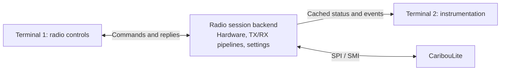

# Runtime profiling, broadcast decoding and CTCSS

Recorded 2026-10-10 against source revision `a4d1ef3`.

The user reports no obvious gaps or pops during NBFM or WBFM listening. The
next requested capabilities are WBFM stereo and RDS, an experimental DAB+
receiver, and adjustable CTCSS for the NBFM transceiver. This document records
a source review and a proposed development order; these features and the
additional instrumentation are not implemented by this review.

## Assessment and evidence

Whole-application profiling is useful before increasing decoder complexity.
Optimize the measured contributors while retaining the accepted FM behavior.
Clean listening is useful functional evidence, but does not establish sample
continuity, worst-case scheduling latency or the available CPU budget.

The fresh HiF/RF24 1 MS/s recording contains 57 confirmed application IQ queue
overwrites, totaling 570,000 samples / 0.57 nominal seconds. All accumulated
between consecutive display snapshots at 98.26 and 99.31 nominal IQ seconds,
after the main transmission. They occurred after the raw-IQ capture tap.
The same log contains one sampled `ALSA=XRUN` state during muted reception;
this confirms a playback underrun, but does not count all underrun events.
The 1,872 radio-layer SMI read timeouts do not establish discarded samples.
Kernel overflow diagnostics were not collected and RF continuity is unverified.
These observations describe the instrumented capture, not a measured failure
rate during the user's subsequent clean listening tests.

See the [capture report](../build/iq-captures/20261010T212317+0200_hif_idle/README.md)
and [XRUN snapshot](../build/iq-captures/20261010T212317+0200_hif_idle/application.log).
Recording performs synchronous writes in the reader, so it can affect timing.

## Instrumentation coverage and hidden issues

| Area | Current coverage or weakness | Required improvement |
| --- | --- | --- |
| SMI reads | Zero/partial reads and debug messages; a timeout is not a loss count | Separate zero, partial, error and overflow counters, with event times |
| Kernel/FPGA continuity | Kernel `counter_missed` counts rejected DMA quarters; no complete source sequence or hardware timestamps | Collect kernel overflow diagnostics; label hardware continuity unknown until independently verified |
| Application IQ FIFO | Puts/gets/overwrites/depth extrema; 64 ten-millisecond blocks | RX sequence, sample offset, enqueue time and discontinuity indication; distinguish queue loss from upstream loss |
| Audio FIFO | Failed `aud10_fifo_put(..., 10)` is ignored; produced count advances anyway | Count successful enqueues and failed/time-out enqueues separately; retain a persistent error/loss indication |
| ALSA | Once-per-second state snapshots and silent `-EPIPE` recovery | Playback underrun and capture overrun/recovery counters; actual period/buffer sizes, delay and event times |
| Scheduling | Failed FIFO scheduling silently falls back; displayed priority is requested priority; `mlockall` result ignored | Report actual policy/priority/affinity and memory-lock result once at startup |
| Worker health | Negative RX reads are retried without a fault policy; audio/DSP workers can exit without publishing a session fault | Persistent worker error/status and coordinated session shutdown/recovery |
| Runtime controls | Atomic squelch controls, but several other live controls/status fields are plain or volatile shared data | Defined ownership and synchronization for reset, gain, de-emphasis, active flags and diagnostics |
| Processing time | DSP-only CPU measurements and cumulative output counts | Per-thread CPU and wall time, stage service/wait times, latency distributions and exceptional events |

Relevant code: [audio enqueue](../software/libcariboulite/src/demod_worker.c),
[transport](../software/libcariboulite/src/pipeline_transport.c),
[scheduling](../software/libcariboulite/src/pipeline_runtime.c),
[RX lifecycle and reader](../software/libcariboulite/src/rx_pipeline.c),
[ALSA playback](../software/libcariboulite/src/alsa_sink.c) and
[capture](../software/libcariboulite/src/alsa_source.c).

Software block sequence numbers can expose losses between the reader and DSP;
they cannot establish continuity before the reader. Discontinuities need an
explicit DSP policy: clear invalid history or reacquire synchronization, with
audio fading and an event indicating what happened.

## Separate control and instrumentation terminals (2026-10-11)

Implementation update: the separate C RX-only backend and passive monitor
are available and have passed a user listening test. Shared instrumentation
now counts successful/failed audio enqueues, ALSA playback underruns and
recovery, completed radio reads and worker lifetime/errors in both the backend
and menu 14. Startup reports actual policy/priority/affinity and scheduling,
memory-lock and query failures. See [counter definitions and comparison procedure](passive-monitor.md#shared-rx-instrumentation-2026-10-11).
The table above records the original review: source discontinuity metadata,
kernel overflow telemetry, detailed stage latency, capture-side ALSA counters
and coordinated fault recovery remain open work. A
[separate C receiver controller](radio-control.md) now implements RX
start/stop, frequency, mode, sample rate and squelch commands. Commands use a
second Unix socket and execute on the backend owner thread. Frequency/mode/rate
edits require stopped RX; squelch edits reuse atomic controls. Checked startup,
stop and tune rollback report failures with the retained configuration.
The accepted `test_app` and shared DSP are unchanged by this milestone.

A [physical NBFM application comparison](rx-application-comparison.md) now
provides a 1 MS/s baseline for both instrumented applications. Menu 14 used
7.90% of one core; backend plus monitor used 9.66% (6.14% + 3.53%). The shared
RX DSP cost was essentially unchanged. All four measurement windows had
zero recorded application queue drops, ALSA underruns and RX errors, with
kernel `missed:0` observations. These short, fixed-frequency measurements do
not establish worst-case latency, FPGA continuity or future decoder budgets.

The user proposes operating TX/RX, mode, squelch, frequencies, sample rate and
bandwidth in one terminal while watching menu-14-style instrumentation in
another. This is feasible with one radio-owning process and separate local
clients. It is a proposed application/control refactor; it does not require
moving the DSP or IQ stream between processes.

Only the backend opens the hardware and owns configuration changes, streaming
and audio. Initially allow one active controller and multiple read-only
observers. Both clients can run in separate SSH terminals on the same Pi. A
local Unix-domain socket suits the small command/status messages; see the
[Linux IPC reference](https://www.man7.org/linux/man-pages/man7/unix.7.html).

### Current coupling and reusable code

The RX/TX pipeline APIs already provide start/stop, lifecycle, frequency and
statistics operations. However, `monitor_modem_status()` in
[app_menu.c](../software/libcariboulite/src/app_menu.c) owns those objects and
saved settings alongside ncurses, extensive hardware polling, rendering and
keyboard handling. Frequency and squelch entry switch to a blocking prompt,
which pauses the current monitor loop while the user types; streaming workers
continue independently. Extract a UI-independent session with commands and
synchronized snapshots, then adapt menu 14 to that interface.

Commands must be serialized by one session owner. A socket reader should
queue validated requests rather than reconfigure or destroy pipelines while
another thread reads them. Replies should identify the command, success/error,
effective settings and current session state. Preserve accepted TX/RX handoff,
Quindar/tail behavior and loopback exclusions.

For the first version, preserve current stop-before-change rules for frequency,
sample rate and receive mode. Live squelch flags and threshold updates can reuse
the existing atomic controls. Bandwidth needs an explicit validated mode
configuration: RX startup currently selects 160 kHz / Fs÷8 for NBFM and
2 MHz / Fs÷2 for WBFM. A one-off register write would be overwritten on start.
Keep modem bandwidth and software channel-filter bandwidth distinct, and show
requested and effective settings in both clients.

### Cost and monitoring behavior

Exchange status/settings, not IQ or PCM. For an illustrative message budget,
a 4 KiB snapshot at 5 Hz is 20 KiB/s per observer. This is a design example,
not a measured message size or CPU result. Extra serialization, socket I/O
and terminal rendering should be small compared with RF DSP at these update
rates, but whole-system CPU and latency must be measured with the actual
prototype. A second process alone does not guarantee an efficiency gain.

Use a configurable status cadence, initially around 2–5 Hz. Sample software
counters separately from modem/mixer registers; extensive hardware diagnostics
can refresh more slowly or on request. Cache one hardware snapshot for all
observers rather than polling the hardware once per terminal. Include monotonic
timestamp, session/configuration generation and freshness/error indicators so
old readings cannot be mistaken for current settings.

Publishing must use bounded, nonblocking queues. A slow observer may miss
display updates while cumulative loss/error counters remain available in the
next snapshot. It must never hold up IQ processing, radio commands or TX stop.
Keep formatting, socket writes and display work outside streaming threads and
hardware locks. Logs should use an aggregated event path with explicit loss
accounting if its bounded queue fills; optional file recording belongs outside
the streaming path. See [Linux socket behavior](https://www.man7.org/linux/man-pages/man7/socket.7.html).

Define disconnect semantics: closing an observer leaves the radio session
running; loss of the active controller during TX should invoke the existing
orderly TX stop. RX persistence and explicit shutdown should be specified by
the session interface. A persistent system daemon is optional; the first
backend can be an ordinary manually launched process.

### Incremental delivery and acceptance

1. Extract the session/command/snapshot interface while retaining menu 14 as
   its frontend. Complete the missing loss, scheduling and worker-health
   counters at this boundary.
2. Add a read-only instrumentation client. Verify attach/detach, status
   freshness and slow-client behavior while the existing frontend controls
   the radio.
3. Add the separate control client and terminal-free backend. Keep one active
   controller initially, with validated settings and acknowledged transitions.

Measure backend and client CPU together, recording monitor disconnected versus
connected, different refresh rates and deliberately stalled clients. Verify
that typing, reconnecting and observer failure do not disturb reception or
delay commands. Exercise command ordering, failed configuration, mode/rate
changes, controller disconnect during simulated TX, repeated start/stop and
the accepted physical TX tail before declaring the separation complete.

This boundary also gives later CTCSS, stereo/RDS and DAB+ decoders a common
place to publish tone/pilot lock, decoded metadata and synchronization/error
metrics without adding hardware ownership to each display.

## Profiling pass

1. Add the missing counters and actual startup configuration first. Rename the
   displayed application FIFO to avoid confusing it with the kernel FIFO, and
   replace the `min_depth == 0` under-run note with an event-based diagnostic.
   An empty queue at startup or between batches is not itself an underrun.
2. Measure reader/decoding, IQ copying, DSP, queue waits, playback writes and
   hardware-lock waits. Record p50/p95/p99.9/max service times, queue-depth
   distributions, sample counts, correction-clamp occupancy and faults.
   Keep natural blocking waits separate from compute time. A long individual
   service time can be absorbed by buffering; evaluate backlog and actual loss.
3. Profile complete NBFM and WBFM sessions at 1/2/4 MS/s. Compare recording
   off/on and full/reduced UI polling, using repeatable RF and audio settings.
   Include startup, steady reception, retune, stop/start and TX/RX transitions
   as separate phases. Record CPU frequency, temperature/throttling, memory,
   per-thread CPU and context switches alongside application events.
4. Use sampling and scheduling traces to attribute expensive code and stalls.
   Aggregate counters outside streaming threads and measure instrumentation
   overhead so logging does not create the behavior under investigation.
5. Make one measured optimization at a time, preserving signal quality and
   streaming behavior; repeat the relevant baseline and a sustained run.

Concrete optimization candidates are full-structure IQ copies (each frame
reserves 40,000 IQ pairs even when only 10,000 are valid), register/UI polling,
streaming-thread logging, synchronous capture writes, FIR/resampling kernels,
and de-emphasis coefficients calculated in the audio sample loop. Their
relative cost has not been established. Caching constant coefficients or
copying only valid samples is a smaller change than redesigning queue ownership.

### Hardware-free WBFM timing check

The existing `test_wbfm_demod.py` passed during this review at all three rates.
Its single timed 0.2-second clean-signal DSP run reported:

| IQ rate | CPU seconds / 0.2 s IQ | Approximate use of one CPU core |
| --- | --- | --- |
| 1 MS/s | 0.032 | 16% |
| 2 MS/s | 0.054 | 27% |
| 4 MS/s | 0.097 | 48.5% |

Reproduce with `python3 software/libcariboulite/tests/test_wbfm_demod.py`.
This is a short, hardware-free, `-O3` test with zero de-emphasis in its timed
case. It excludes transport, workers, queues, UI, audio devices and recording;
it is not a whole-app CPU budget, production-flags comparison or latency
guarantee. CPU frequency was not tracked through the run. Existing production
NBFM measurements are documented in [discriminator timing](nbfm-discriminator-angle.md).

## WBFM stereo and RDS

The WBFM discriminator already produces a private 250 kS/s multiplex stream.
Its current 17 kHz mono low-pass and decimation discard the stereo and RDS
components. The public 48 kHz raw tap is already mono-filtered, so it is not
a suitable decoder input. Branch immediately after discrimination instead.
See [WBFM DSP](../software/libcariboulite/src/wbfm_demod.c) and
[tap contract](../software/libcariboulite/src/audio_demod.h).

Stereo needs 19 kHz pilot recovery, a coherent 38 kHz reference, matched
sum/difference paths, left/right reconstruction, per-channel de-emphasis and
shared-timing resampling. Add pilot-lock quality and mono blending/fallback.
The current PCM FIFO and sink contract are mono; ALSA's stereo fallback
duplicates mono. Extend counts, transport and playback to real stereo frames.
The signal structure is specified in [ITU-R BS.450-4](https://www.itu.int/dms_pubrec/itu-r/rec/bs/R-REC-BS.450-4-201910-I%21%21PDF-E.pdf).

Legacy RDS needs an independent 57 kHz extraction branch, carrier/timing
recovery, differential/biphase decoding and block checkword/group
synchronization before station PI, PS and RadioText can be reported. Metadata
should use bounded events, independent of playback and stereo lock; RDS can
also accompany mono broadcasts. See [ITU-R BS.643-4](https://www.itu.int/rec/R-REC-BS.643-4-202212-I/en)
and its publicly accessible [legacy technical summary](https://www.itu.int/dms_pubrec/itu-r/rec/bs/R-REC-BS.643-3-201105-S%21%21PDF-E.pdf).

Hardware IQ at 1 MS/s is sufficient in principle. Measure the present nominal
100 kHz complex RF filter and 250 kS/s discriminator with full composite
modulation; wider filtering and a higher internal discriminator rate may help
if sideband truncation limits separation or RDS reliability.

Acceptance needs stereo separation versus frequency, channel gain/delay match,
THD+N, pilot leakage/lock/blending, RDS block-error rate and valid groups per
second, and gap/retune reacquisition. Existing tests verify mono rejection of
19/38/57 kHz components, not stereo or RDS decoding.

## DAB+ feasibility

On the full CaribouLite board, HiF/RF24's converter can cover VHF Band III;
RF09 cannot tune that band. DAB+ requires a separate wideband IQ receiver.
A Mode I ensemble occupies approximately 1.536 MHz, so 1 MS/s is insufficient.
The standard elementary rate is 2.048 MS/s. Native supported rates include
2 and 4 MS/s, so start by evaluating 2 MS/s with a wide modem profile and
complex resampling by 128/125. A 4 MS/s alternative uses 64/125. Verify the
actual radio rate and filter response. See [ETSI EN 300 401](https://www.etsi.org/deliver/etsi_en/300400_300499/300401/02.02.01_60/en_300401v020201p.pdf).

The decoder needs timing/frequency synchronization, OFDM FFT/differential
demodulation, deinterleaving and channel decoding, ensemble/service handling,
then DAB+ superframe/error correction and HE-AAC audio decoding. It bypasses
FM discrimination, FM squelch and the sound-device-driven FM resampling servo.
See [ETSI TS 102 563](https://www.etsi.org/deliver/etsi_ts/102500_102599/102563/02.01.01_60/ts_102563v020101p.pdf).

First establish physical reception with an existing decoder, then decide the
integration boundary. [Qt-DAB](https://github.com/JvanKatwijk/qt-dab) documents
Soapy input at 2–4 MS/s with resampling; compatibility with this board has not
been tested here. Measure synchronization losses, FIC CRC success, selected
service errors, audio-decoder failures and CPU load before custom integration.

A separate Soapy bug was found: an unconditional block in
[Cariboulite.cpp](../software/libcariboulite/src/soapy_api/Cariboulite.cpp)
overwrites lower-rate selections with 4 MHz/3; later 2/4 MS/s selections
override it. Thus a nominal 1 MS/s Soapy request does not select 1 MS/s, and an
unsupported 2.048 MS/s request is not valid DAB input. This is separate from
menu 14, which uses the C API. Fix rate validation/selection and test readback
before relying on the Soapy route for new receivers.

## Adjustable CTCSS

Implement independent TX tone encoding and optional RX tone squelch, with
validated adjustable tone frequency and a conventional preset list. Common
equipment lists tones from 67.0 to 254.1 Hz; see this
[Kenwood manual](https://www.kenwood.com/usa/Support/pdf/TM-281A_Manual.pdf).

TX needs a separate continuous-phase oscillator mixed after voice
filtering/pre-emphasis and before FM phase integration. Make tone deviation
explicit, reserve voice headroom so the combined deviation stays within
±2.5 kHz, and verify the resulting RF modulation. Audible tone/Quindar
injection remains a different function. Define CTCSS timing relative to
closing Quindar and tail padding so it cannot inadvertently extend TX or
repeater access.

RX tone detection can branch from normalized raw NBFM discriminator audio
before de-emphasis, gain and muting. Low-pass/decimate the detector branch and
use a narrow tone detector with tone-to-noise qualification and hysteresis.
Reject adjacent tones and voice-induced false detections. Combine enabled
carrier/noise/tone conditions at the audio gate and keep detection running
while muted. Add tone removal or a voice high-pass separately; the existing
5 Hz DC blocker and 3.2 kHz low-pass do not reject CTCSS.

This runs at audio or lower rates, making it a smaller processing addition
than stereo or DAB+, although CPU and detection performance still need tests.

## Recommended implementation order

1. Complete continuity, audio-loss, scheduling and worker-health diagnostics;
   establish whole-app CPU/latency baselines and address measured bottlenecks.
2. Add adjustable CTCSS as a contained NBFM extension, preserving accepted
   TX/RX sequencing and total deviation.
3. Expose the WBFM multiplex boundary and add real stereo output with mono
   fallback; add RDS independently from that same boundary.
4. Prove DAB+ reception through an existing decoder at a verified wideband IQ
   rate, then select and profile a separate decoder/backend integration.

This order is a recommendation, not a commitment that the future features
have been implemented or a measured guarantee of Pi CPU capacity.
