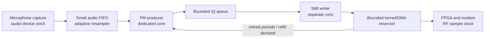

# TX rate diagnosis and a hardware-paced design

Current-source note (2026-10-16): this implementation is merged in commit
`37d2414` and is part of the current source tree. The subsequent installer
update (`953c1f0`) builds the current driver, library, terminal application and
backend/controller/monitor. References below to preserved original files,
runtime-only candidates and deferred installation describe the dated test
sessions; they do not establish which versions are installed or loaded now.
Use [current setup commands](radio-control.md#build-and-start) and
[driver installation](../driver/README.md) for a new installation, and retain
the staged commands when reproducing the frozen experiments.

Recorded 2026-10-14 after the Pi Zero 2 W baseline and follow-up measurements.
The hardware-paced design now includes a verified TX write-timing profile.
Controlled timing-only trials restored near-nominal transport cadence at
1/2/4 MS/s, including five minutes of microphone TX at 4 MS/s. The integrated
production build passed six 180-second TX transport/software trials on the Zero.
Earlier guard failures and their measurements are retained below. The original
baseline, installed module, firmware and original application binaries remain
preserved separately.

On 2026-10-15, the user also reported successful quick listening tests of the
staged version at 1 and 4 MS/s, with substantially better modulation audio at
4 MS/s. This is qualitative listening confirmation; the
[user test record](pi-zero-tx-queue-test-2026-10-15.md#user-listening-checks-2026-10-15)
keeps it separate from the timed transport measurements.

After transferring the same CaribouLite to the Pi 4 on October 15, the unchanged
staged candidate also passed six 180-second microphone/tone trials at 1/2/4 MS/s
and same-backend automatic RX restoration at 1/4 MS/s. All recorded driver,
capture and audio losses/faults were zero, and the same TX 1/4/2/1 and restored
1/5/1/1 timing profiles were verified. The [Pi 4 validation record](pi4-tx-validation-2026-10-15.md)
includes the independent audits, lower measured CPU use, complete cleanup and
preserved installed files. Permanent installation remains deferred.

The user subsequently confirmed perfect Pi 4 modulation audio at 4 MS/s and
no noticeable hiss with a quiet microphone, listening through an RSP2pro with
30 dB + 20 dB attenuation. SDRconnect with AGC enabled indicated −61.2 dBm.
The [manual listening record](pi4-tx-validation-2026-10-15.md#user-rsp2pro-listening-check--4-mss-2026-10-15)
documents this qualitative confirmation and the limits of the nominal power
estimate separately from the automated counters.

## What the measurements distinguish

The following table records the original baseline before the implemented fixes.

The 1 MS/s backlog and the 4 MS/s production shortfall require separate fixes.
Neither disappears simply because RX works at the same requested rate.

| Path | Measured result | Interpretation |
| --- | --- | --- |
| TX 1 MS/s, microphone and tone | Producer approximately 100 frames/s before saturation; writer approximately 99.59; kernel byte cadence approximately 995,919–995,939 IQ-equivalents/s; no kernel misses | Downstream TX consumption does not keep pace with the independent producer timer. Audio capture and CPU exhaustion are not required to reproduce it. |
| TX 1 MS/s, tone, status reduced from 5 to 0.5 Hz | Writer 99.574 frames/s; kernel cadence approximately 995,709 IQ-equivalents/s; queue still reaches 64/64 | Reducing register/status polling tenfold does not resolve the non-nominal transport cadence. |
| RX 1 MS/s | Kernel cadence 999,998 IQ-equivalents/s; no measured application/kernel drops or playback underruns | Receive pacing is essentially nominal. A common host timebase error is not supported. |
| RX 4 MS/s | Kernel cadence 4,000,001 IQ-equivalents/s; no measured application/kernel drops or playback underruns | The receive path sustains its configured rate on this Zero. |
| TX 4 MS/s, original modulator alone | 10.096 ms CPU per 40,000-IQ frame | The original modulator lacks margin for a 10 ms frame deadline even without capture, copying or writing. |

Kernel rates use completed DMA-quarter counts over their own timestamped
intervals. They describe byte movement, not independently measured RF output.
The short RX application-reader estimates are quantized by frame/chunk endpoints;
the table uses the longer kernel callback intervals. RX demodulation cost rose
from 17.11% to 19.88% of one core between 1 and 4 MS/s, whereas TX performs its
costly phase-to-IQ conversion at the full RF rate.

The host monotonic/raw-clock comparison differed by approximately 2.1 ppm over
ten seconds; the read-only frequency correction was approximately 2.5 ppm.
That cannot explain a TX discrepancy around 4,000 ppm. An idealized simulation
of the existing SMI collector, complex FIFO and LVDS transmitter produced exactly
one million FIFO pulls/s with gap 3. It does not reproduce physical SMI handshake,
clock-domain or sample-alignment behavior. At this stage producer pacing alone
did not explain the steady deficit. The subsequent controlled write-timing
experiment restored near-nominal transport at 1 MS/s as well as 2/4 MS/s. The
precise physical SWE sampling mechanism and independently measured RF sample
timing remain unproven; the transport improvement is measured separately.

The original driver also had a separate startup-padding issue: it primed its
four-period DMA ring with raw zero bytes. An isolated
test of the existing SMI collector produces 2048 FIFO words from 2048 raw zero
bytes, versus 512 words from the same number of correctly framed IQ bytes.
The initial 1 MS/s callback delay has an approximately 0.393-second excess,
consistent with that expansion. This explains a startup candidate, not the
continued approximately 0.4% steady deficit. The implemented candidate uses
valid IQ framing for startup padding; its TX-enable semantics are described
below and do not substitute for explicit modem unkeying.

## Why RX is different

RX assembles frames as hardware supplies samples. Its reader, demodulator and
audio writer use CPUs 2, 1 and 0. In NBFM, cheap CIC processing runs at the RF
rate, while FIR, limiting and discrimination operate after decimation to
50 kS/s. Audio-queue feedback already adjusts output resampling slightly.

The original TX design generated exactly 480 audio samples and a fixed RF frame
on a host `CLOCK_MONOTONIC` 10 ms cadence. Its SMI writer was already subject to
hardware backpressure, but the producer had a separate clock. Both TX workers
were placed on CPU 0, and trigonometry ran once per RF IQ sample. RX's healthy
operation therefore does not establish equivalent TX compute capacity or
matching TX clock behavior.

## Hardware-paced TX design

DSP remains on the CPU and follows downstream SMI/DMA demand. Independently
verifying the relationship between that transport cadence and the RF sample
clock remains necessary.

1. **Drive IQ production from refill demand.** Use hardware-driven DMA retirement
   and a queued-sample target to request work. Tone generation can run when
   capacity is available, then wait on a condition variable. Ordinary TX should
   not depend on an independent fixed 10 ms wall timer. Block sizes can remain
   convenient DSP units while their production follows sink demand.
2. **Bound buffering throughout the path.** A smaller application FIFO alone
   is insufficient: legacy `POLLOUT` means the kernel FIFO is not completely
   full. Unpaced production could quickly fill that large FIFO and retain high
   latency. Expose actual kernel occupancy/capacity, completed DMA-period counts
   and repeat counts, and enforce a deliberate refill watermark and total
   buffering budget. Correctly prime valid framed data before starting DMA.
3. **Give capture its own worker and reconcile the clocks.** Drain microphone
   input into a small audio FIFO independently of RF writes. Use gradual adaptive
   resampling based on audio occupancy and verified RF demand. At the measured
   1 MS/s demand, consuming 480 audio samples per RF frame uses only about
   47,804 samples/s from a 48,000-sample/s source. The 3840-sample capture buffer
   would fill in about 20 seconds, matching the first baseline overrun after
   IQ saturation. Removing the producer timer alone would move the backlog into
   capture. RX's existing small correction limits must not be copied blindly
   to compensate this unexplained approximately 0.4% TX discrepancy.
4. **Preserve radio lifecycle and waveform timing.** Express cues and final
   silence in RF sample counts. Retain partial-write accounting, abort/stop
   responsiveness, controller-disconnect unkeying and checked hardware state.
   Keep driver acceptance separate from DMA retirement and estimated RF emission:
   a retired DMA period has entered the SMI path, with ring/FPGA buffering still
   relevant to carrier release.

The current DMA quarter contains 32,768 IQ samples: 32.768 ms at 1 MS/s or
8.192 ms at 4 MS/s. The four-period ring alone represents 131.072/32.768 ms.
Buffer targets and possibly period sizes must be selected with these durations
and worst-case processing/wakeup time in mind. Hardware pacing helps queue
stability; it cannot make an underpowered producer meet an RF deadline.

## Compute capacity for 4 MS/s

Hardware-free experiments on the actual Zero compiled the original modulator
with machine code matching its installed production object. Two scratch variants
changed only phase-to-IQ conversion and retained double-precision phase/time
integration:

| Phase-to-IQ conversion | Median CPU ms per 4 MS/s frame | Isolated compute capacity |
| --- | ---: | ---: |
| Existing double trigonometry | 10.096 | 3.962 MS/s |
| Single-precision trigonometry | 4.740 | 8.439 MS/s |
| Interpolated 2048-entry lookup table | 3.399 | 11.768 MS/s |

Each alternative differed by at most one IQ16 count per component across
20 million tested IQ pairs, including tones, mixed tones, alternating full-scale
input and random input. Those scratch checks established promising numerical
behavior. The selected single-precision implementation subsequently passed
independent software spectral and recovered-audio checks; quantitative live RF
measurements remain separate. The existing compiler
already combines the double sine/cosine calls, so using an explicit `sincos`
call alone provides no optimization.

The implementation selects single-precision trigonometry with the double phase
accumulator retained, alongside separate producer/writer cores.
Moving cores alone leaves approximately 10 ms of producer work per frame and
insufficient margin. Reducing unnecessary full-size frame copies is a further
measurable improvement; reducing the DSP working rate and interpolating IQ is
a larger alternative requiring image-rejection and bandwidth design.

## Implementation sequence and acceptance

The implementation uses these bounds and controls:

- The new fixed-width, versioned driver ABI reports actual FIFO capacity/depth,
  admission limit, DMA geometry, session generation, accepted/dequeued bytes,
  completed periods and underruns. The backend requires this ABI; the terminal
  menu automatically uses it when available and retains legacy pacing on an
  older driver that returns `ENOTTY`.
- Each hardware-paced TX session limits kernel admission to two DMA periods and
  uses four application frames. Producer work has no independent 10 ms timer;
  the writer waits for `POLLOUT` and makes a nonblocking write under the hardware
  lock. Admission is configured while idle before radio activation, which can
  itself start TX DMA. The producer runs on CPU 1 and writer on CPU 2 where
  affinity permits. A steady 4/4 application queue is intentional prefill within
  this fixed bound, rather than the former growing 64-frame backlog.
- While SMI is idle, hardware-paced TX snapshots canonical `GET_SETTINGS`,
  changes only write setup/strobe/hold to **1/4/2**, and verifies all named
  settings before activation. Read timings, write pace, packing, width and DMA
  flags/thresholds retain their actual values; canonical DMA readbacks such as
  62/47 are compared directly. Stop, abort and start-failure cleanup restore the
  saved write tuple into a freshly read current profile before RX handoff.
  A failed restore remains visible and retains its saved tuple for a destroy
  retry. Legacy mode leaves write timing unchanged. Status exposes the actual
  readback through `tx.smi_timing`.
- A capture worker on CPU 0 drains the microphone into an 8192-frame audio
  buffer. Linear adaptive resampling targets 3360 frames (70 ms), permits up to
  ±4% correction and slews at no more than 100 ppm per 480-output-frame block.
  Occupancy feedback uses proportional gain 0.75 and integral gain 0.2, with a
  0.5-second occupancy filter and bounded allowance for a pending capture period.
  Five nominal seconds of continuously clamped desired correction cause an
  explicit `-ERANGE` fault; applied correction may still be slewing when that
  count begins. Starvation and overflow also fault rather than insert silence
  or overwrite audio. Cue replacement explicitly discards excess microphone
  audio while retaining recent audio; this is reported separately from loss.
- Phase and timing retain double precision; final IQ conversion uses `sinf` and
  `cosf`. Cues retain their RF sample counts. Tail padding covers the effective
  admission limit, DMA ring and FPGA buffering rather than allocated FIFO size.
- Before DMA activation, the parked owner computes one FM frame from zero audio
  and enqueues it while the writer remains gated. It is one of the ten opening
  zero-audio frames: the producer supplies the remaining nine, followed by the
  unchanged 25-frame cue and five post-cue frames. This is an unmodulated FM
  carrier frame at the retained phase, distinct from driver zero-IQ padding.
  Hardware cue stages wait on a condition variable between owner updates,
  avoiding uncounted extra silence. No application IQ is written before profile
  verification; abort and cancellation interrupt that wait.
- Bounded sessions prime valid zero-IQ words before DMA starts and insert valid
  zero IQ on a shortage instead of replaying stale audio. Existing FPGA logic
  holds LVDS `TX_EN` high even when the frame control bit is zero; quiet padding
  does not unkey the radio. Normal stop/abort still disables the transport and
  modem explicitly. The collector also has a one-byte startup alignment effect;
  this phase does not change FPGA firmware.

Driver function tests, RTL framing tests, numerical FM tests, worker lifecycle
regressions and audio clock tests pass. Audio tests include 600-second virtual
runs with ±3.3% clock differences, actual 32768-IQ DMA retirement bursts,
capture jitter and a 2 MS/s transport step from 2.006 to 2.060/2.066 million
IQ-equivalents/s at 60 seconds. The latter retain at least 749/416 captured audio
frames without starvation, overflow or a clock fault. A +5% source/output clock
difference triggers the ±4% guard explicitly after 240000 output frames. Both
standard and backend compiler flags pass. Timing lifecycle tests verify
canonical readback preservation, default/nondefault restoration, failure retry
and exact opening-prefix counts. A deterministic 12 ms first-producer delay at
4 MS/s still supplies the first 32768-IQ refill by 8.192 ms from the precomputed
frame. These checks complement the physical timing experiment below; they do
not establish calibrated RF performance.

Repeat the original microphone/tone baseline at 1/2/4 MS/s. Require stable bounded
latency, sufficient sustained IQ generation, no capture loss or kernel repeats,
and correct RF/deviation, cue and stop behavior. Include long-running tests and
controlled stalls/partial writes; preserve recorder overhead or measure its effect
separately. A stable application queue alone is insufficient acceptance evidence.

The status protocol remains version 1, with optional driver/audio-buffer/capture
worker fields. The packet ceiling is now 16384 bytes; deploy backend, monitor and
recorder together. Older snapshots remain readable with unavailable new metrics.

The staged reload helper, [tx_driver_reload.sh](../driver/tools/tx_driver_reload.sh),
checks the target kernel, exclusive device ownership and rollback module before
a runtime-only reload. It verifies the new ABI while idle and restores the saved
original module if loading or validation fails. Installed module files are not
replaced. It was used to load the candidate on the Zero for these measurements;
the installed rollback module remains unchanged. The Zero's `sudo` password was
entered in its terminal.

## Initial physical trials and revised qualification

All trials use the user's dummy load at **430.100 MHz**, requested −12 dBm,
with the existing FPGA firmware. The first prototype used a 40 ms audio target,
±2% correction and proportional gain 1.0. Microphone TX at 1 MS/s completed
180 seconds with matched put/get rates of 99.594 frames/s, no capture loss or
driver underruns, and a bounded audio queue. Its approximately +4000 ppm audio
correction accommodates the observed transport cadence; it does not repair or
explain that cadence.

Microphone and internal-tone TX at 4 MS/s each completed 180 seconds. The producer
used **54.24%/54.39% of one core**, and completed **101.040/101.096 frames/s**.
Both stable intervals had zero driver underruns and writer errors; microphone
capture had zero overruns and ASRC underflows/overflows. The application queue
stayed within four frames. These results demonstrate production capacity on the
Zero, while the measured approximately 4.04-million-IQ/s transport cadence
remains distinct from independently measured RF timing.

The first 2 MS/s microphone run stopped after about 68.7 seconds on its explicit
±2% clock guard. Around 62 seconds, FIFO-dequeue demand rose from approximately
2.006 to 2.055 million IQ-equivalents/s while real capture remained near
48000 frames/s. The source queue drained; the demanded correction exceeded the
prototype's guard. There were no capture overruns or driver underruns before the
fault. This is a transport/audio-clock mismatch, not evidence of insufficient
microphone capture capacity.

The revised ±4% guard is therefore paired with a tested **70 ms** reserve and
moderate proportional gain. Widening the guard alone left the 40 ms queue unable
to cover the retained slew: a −3.3% startup mismatch exhausted it after 1.16
seconds. The theoretical slew deficit alone needs about 54 ms, before capture
periods and DMA bursts. Gain 0.75 prevents an admissible step from requesting the
guard continuously for five seconds merely while rebuilding that reserve.

**The revised qualification stopped on a clock fault.** The suite started on
October 14 at 22:03:26 Brussels time with the ±4% / 70 ms implementation.
Microphone trials at 1 and 2 MS/s completed their 180-second target without
capture loss or stable driver underruns. The 4 MS/s microphone trial stopped
after about 169 seconds on `-ERANGE`; the three tone trials were not reached.
Its report and raw artifacts (`build/radio-backend/tx-hardware-paced-zero-final-20261014/README.md`)
remain separate from the earlier successful prototype trials.

Late in the 4 MS/s trial, native FIFO-dequeue demand increased from approximately
4.04 to **4.19 million IQ-equivalents/s**, while real capture remained near
48000 frames/s. Over the final 4.83 healthy seconds, producer audio demand was
50133 frames/s versus 48024 captured, requiring approximately **−4.21%**
input/output correction. The source queue drained while the applied ratio
slewed toward its −4% guard. No new capture overrun, read error or driver underrun
was observed during that healthy interval; one driver underrun already existed
before its first stable snapshot. The guard then stopped TX. This requires
further transport diagnosis; the qualification does not establish all-rate
acceptance. Audible modulation, deviation, spectrum and independently measured
RF sample timing remain separate acceptance checks.

## Controlled write-timing experiment and current qualification

A diagnostic linked to the frozen production objects changed only SMI write
setup/strobe/hold from **1/5/1 to 1/4/2**. Both tuples total seven SMI ticks.
Read timings, write pace, clock settings, DMA geometry, FPGA firmware, modulation,
worker placement and audio-buffer policy were preserved. Canonical settings
readback verified the three changes and all other settings. The earlier byte
cadence deficit/excursions disappeared in these controlled trials:

| Source / RF rate | Stable endpoints, s | Completed frames/s | Accepted IQ, MS/s | New stable driver underruns |
| --- | ---: | ---: | ---: | ---: |
| Microphone / 1 MS/s | 179.71 | 99.9966 | 0.999964 | 0 |
| Microphone / 2 MS/s | 179.73 | 100.0024 | 2.000076 | 0 |
| Microphone / 4 MS/s | 299.69 | 100.0000 | 4.000083 | 0 |
| Internal tone / 4 MS/s | 179.75 | 100.0007 | 4.000002 | 0 |

Microphone capture overruns, source/read errors and ASRC underflows, overflows
and clock faults were zero. Its sampled mean corrections were approximately
−46/−33/−26 ppm at 1/2/4 MS/s. These small corrections replace the earlier
thousands-of-ppm compensation. Original and measured file hashes were verified,
with no remaining radio owner/socket after each suite. A single startup underrun
preceded the tone trial's stable interval; the production precomputed frame is
tested specifically against that first-refill margin.

The SWE sampling study (`build/radio-backend/tx-swe-sampling-study-20261014/README.md`)
also found framing failures with old timing under selected artificial jitter,
while 1/4/2 preserved framing across 761 cases. Together these support the
write-timing change. They do not measure physical jitter, establish its exact
electrical mechanism, or independently calibrate RF emission.

At this stage, the Pi 4 source and CMake test application built successfully.
The timing-only physical results in this section apply to the Pi Zero 2 W
with kernel `6.18.50+rpt-rpi-v8` and runtime module
source version `29FA4AB8842B3807F97F0A5`. The installed original module
`697F3CF2096C282E312BA14` remains unchanged and returns after reboot; the matching
candidate can then be loaded with the reload helper, which saves the original
for rollback. Use the isolated checkout's
[candidate launch and reload commands](radio-control.md#tested-pi-zero-staging-checkout),
since the original checkout's backend binary was deliberately preserved.
USB/Loopback bridges and FPGA firmware are unchanged.

**Production TX transport qualification passed.** The integrated
apply/verify/restore and precomputed-frame implementation completed the six
microphone/tone trials at 1/2/4 MS/s, targeting 180 seconds per case, between
**23:00:11 and 23:18:20 Brussels time on October 14**. Stable snapshot endpoints
span 179.6–179.8 seconds. An independent checker passed all 216 checks against
the raw observations, alongside separate file-hash and cleanup verification.
The earlier failed qualifications remain separate implementation snapshots.

| Source / RF rate | Stable endpoints, s | Completed frames/s | Accepted IQ, MS/s | Producer / writer CPU, % of one core |
| --- | ---: | ---: | ---: | ---: |
| Microphone / 1 MS/s | 179.61 | 99.9965 | 0.999973 | 13.87 / 4.63 |
| Microphone / 2 MS/s | 179.80 | 99.9992 | 1.999961 | 26.64 / 14.85 |
| Microphone / 4 MS/s | 179.67 | 100.0026 | 4.000036 | 54.67 / 14.60 |
| Internal tone / 1 MS/s | 179.76 | 100.0044 | 1.000017 | 15.24 / 4.64 |
| Internal tone / 2 MS/s | 179.75 | 100.0024 | 2.000036 | 49.84 / 8.16 |
| Internal tone / 4 MS/s | 179.66 | 100.0045 | 4.000111 | 53.78 / 14.64 |

All six trials had zero driver underrun totals in valid startup, stable TX and
post-stop observations, plus zero writer errors and terminal faults. Microphone
capture overrun/recovery/read-error totals and ASRC underflow, overflow, lost
frame and clock-guard totals were zero. Capture remained approximately
48000.5–48000.7 frames/s; sampled ASRC mean corrections were −100/−96/−59 ppm
at 1/2/4 MS/s. Stable cue-discard deltas were zero; intentional capture discard
during cues remains separately counted.

Actual TX setup/strobe/hold/pace read **1/4/2/1**, and stopped readback returned
to **1/5/1/1**. The application queue intentionally prefilled its four-frame
bound, with matched production/consumption and no growing backlog; the driver
stayed within two native periods. Expected partial writes remained accounted
for. First/last valid cumulative driver counters cover startup/stop outcomes,
although transition snapshots do not timestamp the first DMA callback. The
original 4 MS/s microphone/tone producer used 87.99%/89.18% of one core while
achieving only 82.81/88.84 frames/s; the production implementation now sustains
approximately 100 with substantial producer margin. Variations between the
2 MS/s tone and microphone CPU measurements are recorded without an untested
causal attribution.

The optimized virtual stop-deadline fixture also passes on the Pi Zero. It
retains all 216 scenarios, assertions and a 30-second execution limit; `-O2`
removes the unoptimized simulator's wall-time limitation. Physical automatic
RX restoration also passed at 1 and 4 MS/s, as detailed below. RF emission
timing, modulation, deviation, spectrum and cue audibility remain unmeasured
by these counters.

For final software/transport acceptance, verify all six cases complete; actual
TX timing reads 1/4/2; application/driver occupancy stays within four frames/two
periods; source, writer, ASRC and driver loss counters stay clear; and measured
rates remain nominal within counter endpoint quantization. Record the first DMA
refill and a longer 4 MS/s microphone interval, not only stable-window deltas.
Review CPU/throttling, shutdown, file hashes and device ownership separately.

The same-backend physical handoff test began with stable RX and saved canonical
SMI settings, ran five seconds of tone TX, then stopped normally and observed
automatic RX restoration for **29.925/29.931 seconds at 1/4 MS/s**. IQ/audio
counters advanced with preserved RX configuration and restored 1/5/1 write
timing. Kernel movement was **1,000,010.83/4,000,006.56 samples/s** over its own
callback intervals; application-reader estimates are separately quantized by
frame endpoints. IQ/audio queue drops and put timeouts, reader errors, playback
underruns/recovery failures/write errors and kernel missed counters were zero;
workers remained healthy. Final RX stop verified modem/SMI idle, with no radio
owner or private socket/backend left. Original/staged binary hashes and audio
bridges remained unchanged. Mock tests separately cover disconnect, failed-start
and abort restoration. RF audio, deviation and spectrum checks remain separate.

## Evidence and artifacts

Paths under `build/` identify raw artifacts retained on the original test hosts,
excluded from Git and unavailable in a fresh clone. The tables and conclusions
in these documents preserve the validation summaries; committed tools can
collect new runs.

- [Original physical baseline](pi-zero-tx-queue-test-2026-10-15.md#physical-baseline-results-2026-10-14).
- Initial hardware-paced 1/2 MS/s trials (`build/radio-backend/tx-hardware-paced-zero-baseline-20261014/README.md`),
  including the stopped 2 MS/s run and raw status/events.
- Completed prototype 4 MS/s microphone/tone trials (`build/radio-backend/tx-hardware-paced-zero-4M-20261014/README.md`)
  and cleanup/hash verification (`build/radio-backend/tx-hardware-paced-validation-20261014/verification-cap2-4M.json`).
- Revised qualification stopped during 4 MS/s (`build/radio-backend/tx-hardware-paced-zero-final-20261014/README.md`),
  with paired capture, producer and native DMA counters.
- Timing-only 4 MS/s tone (`build/radio-backend/tx-timing-142-zero-tone4M-retry-20261014/README.md`),
  five-minute 4 MS/s microphone (`build/radio-backend/tx-timing-142-zero-mic4M-20261014/README.md`)
  and 1/2 MS/s microphone (`build/radio-backend/tx-timing-142-zero-mic1M2M-20261014/README.md`)
  reports, with verified original/changed timing in their backend logs.
- Completed production six-case report (`build/radio-backend/tx-hardware-paced-zero-production-20261014/README.md`),
  independent qualification (`build/tx-hardware-paced-live-watch-20261014/qualification/qualification.json`)
  and cleanup/hash verification (`build/radio-backend/tx-hardware-paced-validation-20261014/verification-production.json`).
- Pi Zero optimized virtual deadline results (`build/radio-backend/tx-hardware-paced-validation-20261014/zero-stop-deadline-optimized.log`).
- Physical RX→TX→RX handoff results (`build/radio-backend/tx-rx-handoff-zero-retry-20261014/handoff-summary.json`)
  and final cleanup/hash verification (`build/radio-backend/tx-hardware-paced-validation-20261014/verification-handoff.json`).
- Implementation: [TX pipeline](../software/libcariboulite/src/tx_pipeline.c),
  [audio capture/ASRC](../software/libcariboulite/src/tx_audio_buffer.c) and
  [clock/burst/cancellation tests](../software/libcariboulite/tests/test_tx_audio_buffer.py).
- TX transport arithmetic and RTL experiments (`build/radio-backend/tx-1m-diagnosis-20261014/README.md`),
  with `clock-query.json` and startup zero-padding bench.
- DSP timing, numerical checks and scratch sources (`build/radio-backend/tx-dsp-diagnosis-zero-20261014/README.md`).
- RX 1 MS/s (`build/radio-backend/rx-pacing-zero-1M-20261014/pacing-summary.json`)
  and 4 MS/s (`build/radio-backend/rx-pacing-zero-4M-20261014/pacing-summary.json`)
  timing, with raw snapshots, kernel logs and normal-cleanup evidence.
- Reduced-cadence TX comparison (`build/radio-backend/tx-diagnostic-zero-1M-status05-20261014/pacing-comparison.json`)
  and its generated report/raw logs. Radio returned to idle and runtime binary
  hashes remained unchanged.
