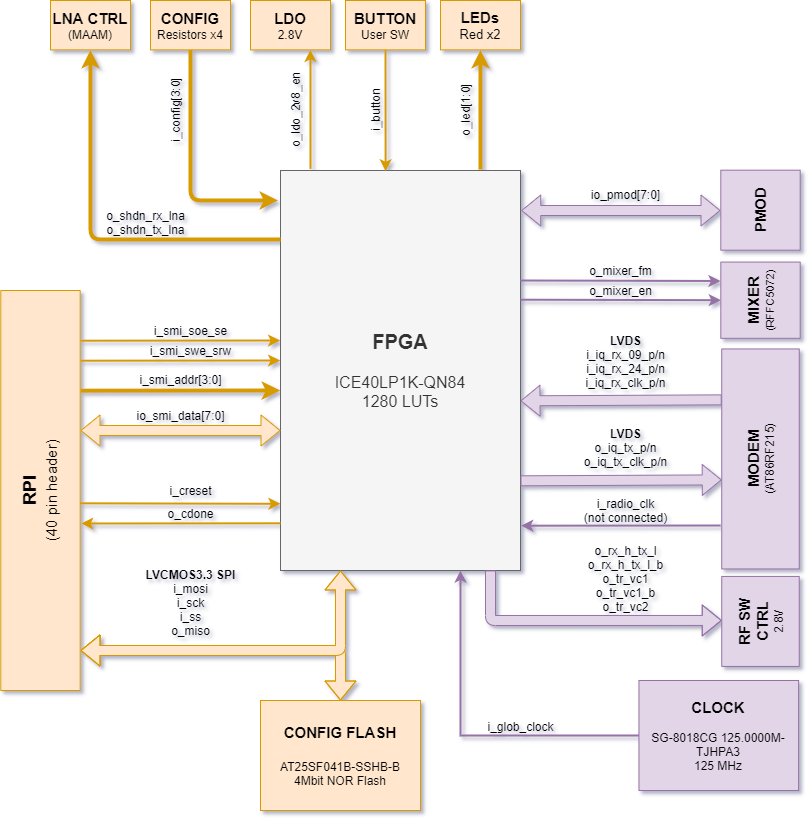
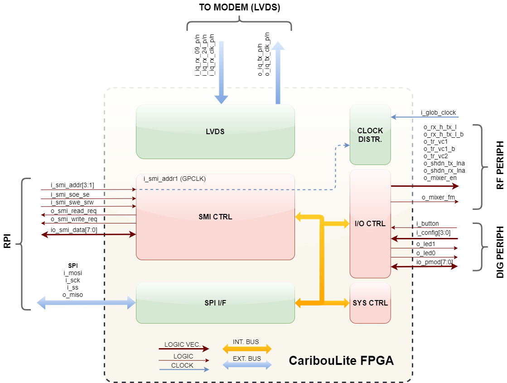
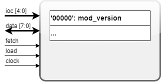

# Overview

Register notes below were checked against the current RTL on 2026-09-16.
Historical diagrams may describe intended features; implementation differences
are called out explicitly. Physical timing/electrical validation remains in
[DOC-03 and DOC-04](../ROADMAP.md#documentation-validation-backlog).

Current-source review on 2026-10-16 confirmed that the RTL and packaged
bitstream remain the September 16 loopback-capable baseline. `top.bin` SHA-256:
`dcdf0733ef1ee8088b82381148475a6e4de87c6f00b8d14480a46d48621d31f6`.
The October 15 [hardware-paced TX](../docs/tx-hardware-paced-design.md) changes
are in the driver and userspace; they do not require new FPGA firmware.
LVDS timing optimization and PMOD sequencer integration remain planned.

CaribouLite contains an FPGA device (ICE40 family) with 1280 LE. It has two designated roles:
1. Step #1: Controlling and managing the RF front-end path, and other digital device control.
2. Step #2: Streaming SMI I/Q data from the RPI to the modem, and from the modem LVDS back to the SMI interface.

The above block diagram shows the FPGA's peripheral connections and their naming.

## Conventions
* i_<signal>: input signal
* o_<signal>: output signal
* io_<signal>: input / output signal (controllable pin)

# FPGA Internal Blocks

In the above diagram, the FPGA internal blocks of logic are shown. These blocks are segmented into Pink (Step #1) and Violet (Step #2).
Each subblock has a communal interface structure, module ID (within the system) and module version.
The subblocks are described below.

# Generic Block Structure
This chapter describes the structure of a generic block within the FPGA internal blocks (SYS, IO, etc.). The minimal interfaces are shown below.

* All blocks shall respond to a default `'00000'` opcode with their module-version.
* The blocks have a 5-bit `IOC` interface carrying the internal opcode.
* The input/output data have the width of 8-bits
* The generic module shall contain a clock input signal and will operate in a synchronous manner.
* The `fetch` signal shall "request" data (read operation) when it is asserted.
* The `load` signal shall "update" internal data (write operation) when it is asserted.
* the `load` and `fetch` signals shall not be asserted simultaneously.

## SYS_CTRL - System Management Controller
This controller is in charge of communicating with the host, receiving instructions (over SPI), and delivering them to other subblocks. The SPI communication logic is integrated within this module and it is based on 2-byte transactions on each chip-select session - OPCODE => DATA. A two-byte transaction requires at least 16 SCK periods: 3.2 microseconds
at 5 Mbit/s, excluding chip-select and host overhead. Actual update latency
requires measurement; the previous claim of less than 500 ns was incorrect.

## Opcode Structure
The Opcode is of 8-bit with the following structure:
| B7 | B6 | B5 | B4 | B3 | B2 | B1 | B0 |
|----|----|----|----|----|----|----|----|
| R/W|MID1|MID0|IOC4|IOC3|IOC2|IOC1|IOC0|

* `R/W` - a read / write indicator:
    * `'0'`: Read operation - fetching data IOC from the submodule MID
    * `'1'`: Write operation - loading data IOC to the submodule MID
* `MID[1:0]` - Module ID as follows:
    * `'00'`: SYS_CTRL
    * `'01'`: IO_CTRL
    * `'10'`: SMI_CTRL
    * `'11'`: Reserved for future expansion
* `IOC[4:0]` - Module Internal OpCode - these 5 bits will be further decoded by the submodule.

**Note #1**: `IOC = '00000'` is reserved for the READ-ONLY 'mod_version' property along with all modules thus it is not usable nor writable. This IOC shall not implicitly be described further in this document as it is the same for every module.

**Note #2**: The read-only (RO) properties shall not be writable and any attempt to write over them (i.e. `R/W='1'`) will be ignored without any feedback to the host.

**Note #3**: IOCs that are not currently used by the modules shall be reserved for future expansions.

## Internal OpCodes (IOCs)

### IOC'00001': sys_version

**Access Type**: Read Only

**Description**: The version of the firmware currently running on the FPGA

**Byte Structure**:

| B7 | B6 | B5 | B4 | B3 | B2 | B1 | B0 |
|----|----|----|----|----|----|----|----|
| SV7|SV6 |SV5 |SV4 |SV3 |SV2 |SV1 |SV0 |

### IOC'00010': sys_manufacturer_id

**Access Type**: Read Only

**Description**: The firmware designer ID - along with the system version above gives a good identification of the system currently running. The `sys_manufacturer_id` of BabelBees shall be '00000001'.

**Byte Structure**:

| B7 | B6 | B5 | B4 | B3 | B2 | B1 | B0 |
|----|----|----|----|----|----|----|----|
| MI7|MI6 |MI5 |MI4 |MI3 |MI2 |MI1 |MI0 |

### IOC'00011': sys_error_status

**Access Type**: Read Only

**Implementation status**: `sys_ctrl.v` declares this opcode but has no read
case or error accumulator for it. A read does not provide the documented RO-write
error bit and can retain a previous response. Error reporting is unfinished;
see DOC-03 in the roadmap.

### Additional implemented SYS opcodes

| IOC | Access | Current `sys_ctrl.v` behavior |
| --- | --- | --- |
| `00101` | Write | Debug flags; bit 3 drives TX interface loopback. Bits 0–2 are stored but their output connections are commented out. |
| `00110` | Read/write | Bits 3–0: TX sample gap; bits 4/5: RX09/RX24 sync-type flags; bits 6/7: TX09/TX24 sync-type flags. |
| `00111` | Write | Software sync levels: bits 0/1 RX09/TX09, bits 2/3 RX24/TX24. |

`top.v` selects PMOD inputs for TX sync when the corresponding type bit is set;
RX sync inputs remain connected to software levels. Register storage alone does
not imply external RX synchronization support. See the
[FPGA study](../docs/fpga-gap-study-2026-09-13.md) and [simulation notes](tests/README.md)
for gap and loopback validation limits.

## IO_CTRL - Pin-level I/O Controller
The IO_CTRL module is in charge of configuring and reading the Pin-IO resources of the FPGA. It spans over LED control, RF switching, power management, and more.

### IOC'00001': data_io_ctrl_mode

**Access Type**: Read / Write

**Description**: The functional mode-of-operation of the system.

**Byte Structure**:

| B7 | B6 | B5 | B4 | B3 | B2 | B1 | B0 |
|---|---|---|----|----|----|----|----|
|RES|RES|RES|RFM2|RFM1|RFM0|DBG1|DBG0|

* `DBG[1:0]` - Debug mode operation
    * `'00'`: No-debug mode - the RFM field describes a set of pre-determines modes of operation
    * `'01'`: Debug mode - the RFM field directives are ignored and the RF-I/O settings are explicitly set in pin-level
* `RFM[2:0]` - RF Mode of operation - this setting is active only when DBG='00'
    * `'000'`: Low-power / inactive mode - all RF peripherals are turned off (LNAs, Mixer, etc.)
    * `'001'`: Bypass mode - the RF front-end wide-range tuning is turned off, and the modem 2.4GHz channel is operated within its **native frequency range (2.4 - 2.483 GHz)**. The LNAs are switched off.
    * `'010'`: RX Lowpass mode - the RF frontend is set into RX mode (LNA active, PA deactivated) and is tuned to **receive high-frequency signals (>2.483 GHz)**.
    * `'011'`: RX Highpass mode - the RF frontend is set into RX mode (LNA active, PA deactivated) and is tuned to **receive low-frequency signals (<2.4 GHz)**.
    * `'100'`: TX Lowpass mode - the RF frontend is set into TX mode (LNA deactivated, PA active) and is tuned to **transmit low-frequency signals (<2.4 GHz)**.
    * `'101'`: TX Highpass mode - the RF frontend is set into TX mode (LNA deactivated, PA active) and is tuned to **transmit high-frequency signals (>2.4 GHz)**.
    * `'111'`: Reserved.

### IOC'00010': data_io_ctrl_dig_pin

**Access Type**: Read / Write (bits [1:0]); inputs read at bits [7:3]

**Description**: Digital pin control and read

**Byte Structure**:

| B7 | B6 | B5 | B4 | B3 | B2 | B1 | B0 |
|---|---|---|----|----|----|----|----|
|BTN|CFG3|CFG2|CFG1|CFG0|LDO28|LED1|LED0|

* `BTN` (ReadOnly): The current user push-button state (the 'USR' button on the PCB). While pushed, `BTN='0'`, otherwise `'1'`.
* `CFG[3:0]` (ReadOnly): The configuration resistors current state (R[41:38] respectively on the PCB). Assembled resistor shall show `'0'` value, otherwise `'1'`.
* `LDO28`: historical bit label only. Current `io_ctrl.v` does not write or assign readback bit 2; do not treat it as an implemented power control.
* `LED1`: controlling the LED 'LD2' state on the PCB - `'1'`: on, `'0'`: off.
* `LED0`: controlling the LED 'LD1' state on the PCB - `'1'`: on, `'0'`: off.

### IOC'00011': data_io_ctrl_pmod_pin_dir

**Access Type**: Read / Write

**Description**: PMOD connector bits IO pin direction

**Byte Structure**:

| B7 | B6 | B5 | B4 | B3 | B2 | B1 | B0 |
|---|---|---|----|----|----|----|----|
|PMODD7|PMODD6|PMODD5|PMODD4|PMODD3|PMODD2|PMODD1|PMODD0|

* `PMODD[7:0]`: stored/read back by `io_ctrl.v`, but not connected to physical pin direction control in `top.v`. The top level declares four inputs and four outputs. This is not an implemented eight-pin bidirectional GPIO interface.

### IOC'00100': data_io_ctrl_pmod_pin_val

**Access Type**: Read / Write

**Description**: PMOD connector bits IO pin value

**Byte Structure**:

| B7 | B6 | B5 | B4 | B3 | B2 | B1 | B0 |
|---|---|---|----|----|----|----|----|
|PMOD7|PMOD6|PMOD5|PMOD4|PMOD3|PMOD2|PMOD1|PMOD0|

* The implementation stores only bits 3–0 and returns zero in bits 7–4.
  The IO controller's PMOD output connection is disabled in `top.v`; reads return
  stored state, not sampled connector levels. The old configurable weak-pull-up
  claim is unsupported by this RTL. Pin mapping, electrical limits and intended
  PMOD functionality remain DOC-04.

### IOC'00101': data_io_ctrl_rf_pin_state

**Access Type**: Read / Write

**Description**: Setting up / reading out the pin values controlling the RF front-end path switches.

**Byte Structure**:

| B7 | B6 | B5 | B4 | B3 | B2 | B1 | B0 |
|---|---|---|----|----|----|----|----|
|RXH|RXH_b|TRVC1|TRVC1_b|TRVC2|LNATX|LNARX|MXREN|

* `RXH` - the value of the `RX_H_TX_L` signal in the PCB. This value is writeable and readable while the complement value at Bit#6 (`RXH_b`) is directly inferred from it (`RXH_b=~RXH`).
* `TRVC1` - the value of the `TRVC1` signal in the PCB. This value is writeable and readable while the complement value at Bit#4 (`TRVC1_b`) is directly inferred from it (`TRVC1_b=~TRVC1`).
* `TRVC2` - the value of `TRVC2` signal in the PCB.
* `LNATX` - controlling the Transmit PA operation, `'1'`: Shutdown, `'0'`: Operational.
* `LNARX` - controlling the Receive LNA operation, `'1'`: Shutdown, `'0'`: Operational.
* `MXREN` - readback reports `mixer_en_state`, but `io_ctrl.v` ties its `o_mixer_en` output high and `top.v` leaves that port disconnected. Register state does not establish physical mixer disable.

### Mixer FM registers (historical proposal)

`io_ctrl.v` defines no mixer FM prescale or data opcode, and ties `o_mixer_fm`
low. The old second `00101` heading also collided with the RF pin register.
There is no implemented mixer FM register contract to document; decide whether
this feature is needed before assigning opcodes (DOC-03).

## Clocking

There is no separate `CLOCK_CTRL` module in this tree. `top.v` divides
`i_glob_clock` by two with `r_counter` to generate `w_clock_sys`. LVDS logic
uses the modem receive clock through FPGA input/global buffering. Consult
[top.v](top.v) and the [timing study](../docs/fpga-gap-study-2026-09-13.md);
a complete clock-domain/timing specification remains DOC-03/DOC-04.

## SMI_CTRL — SMI/LVDS streaming interface

[smi_ctrl.v](smi_ctrl.v) transfers 32-bit FIFO words over the eight-bit SMI bus.
RX emits bytes least-significant first; TX assembles four bytes per word. RX
read requests reflect a nonempty FIFO; TX write requests reflect a nonfull FIFO.
LVDS framing is implemented separately in `lvds_rx.v` and `lvds_tx.v`.

Current `smi_ctrl.v` assembles FIFO words with TX-enable hardcoded high even
when the host word's control bit is zero; `lvds_tx.v` serializes those words.
Valid zero-IQ startup/underrun padding preserves framing but does not unkey RF.
Userspace must stop SMI and disable modem TX explicitly. Historical
`TX_EN = I[0]` notes describe the modem interface, not the current RTL's
propagation of host control.

| IOC | Access | Meaning |
| --- | --- | --- |
| `00000` | Read | Module version (1). |
| `00001` | Read | Bit 0 RX FIFO empty; bit 1 TX FIFO full; bit 2 selected channel; bit 4 direction; other bits zero. |
| `00010` | Write | Bit 0 selects channel (0 RF09, 1 RF24). Read selection through FIFO status. |
| `00011` | Write | Bit 0 selects direction (0 TX, 1 RX). Read selection through FIFO status. |

Simulation coverage does not establish physical asynchronous-interface timing;
see [tests/README.md](tests/README.md).

# License
 This work is licensed under a <a rel="license" href="http://creativecommons.org/licenses/by/4.0/">Creative Commons Attribution 4.0 International License</a>.

## Building firmware reliably

Run `make -C firmware build` with GNU Make 4.3 or newer, Yosys,
nextpnr-ice40, icepack, and `software/utils/generate_bin_blob` available.
The default target is also `build`. The flow is:

1. All top-level Verilog files → `top.json` and `top.blif`.
2. JSON and `io.pcf` → `top.asc` and `nextpnr_timing.json`.
3. Routed ASC → `top.bin`.
4. Binary → the firmware header and library's copy of that header.

Routing uses the validated LP1K/QN84 seed-16 settings and must meet timing;
there is no `--timing-allow-fail`. Synthesis and routing logs are saved as
`synthesis.log` and `nextpnr.log`, and printed if the corresponding tool fails.
Each stage writes temporary files and publishes them only on success. A
failure stops downstream stages while retaining earlier successful artifacts;
an old bitstream remaining on disk is not evidence that the new build passed.
The Makefile itself is a prerequisite, so changing it triggers rebuilding.

A normal build never programs hardware. `prog` builds first and then invokes
`PROG`; `prog_only` explicitly programs the existing image without rebuilding.
Set `PROG` to an appropriate board programmer when using these targets.
Tool locations can be overridden with `YOSYS`, `NEXTPNR`, `ICEPACK` and
`BLOBGEN`; `LIB_HEADER` can redirect the library header for isolated builds.
Use a clean isolated copy when changing tool versions or command-line tool
variables: Make does not track those external changes.

`make clean` removes local generated synthesis/routing/bitstream/header files;
it does not remove the copied library header. Preserve a validated image or
use an isolated checkout before cleaning. See `tests/README.md` for checks.

The next planned firmware development test is
[LVDS Fmax improvement before sequencer integration](../docs/lvds-fmax-next-test-2026-10-08.md).
It starts from the physically tested main firmware and defines isolated build,
receive-behavior and physical acceptance checks before reintroducing the PMOD
prototype. The proposed optimizations have not yet been implemented.
